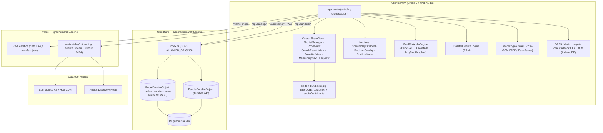

# GradMix — PWA de Mezcla Continua Auto-DJ, Catálogo en Streaming y Salas Colaborativas

**GradMix** es una Progressive Web App (PWA) de **código abierto** diseñada para operar como reproductor continuo de fiestas con transición **Auto-DJ (Equal-Power Crossfade)** en doble deck (`A` / `B`), biblioteca local persistente en **OPFS / carpeta del dispositivo**, buscador aislado en memoria RAM conectado a catálogo remoto, compartición cifrada **E2EE** por WhatsApp, exportación/importación `.zip` / `.gradmix` y salas colaborativas temporales en tiempo real.

Está pensada para **uso personal y grupos pequeños** — una fiesta, una reunión, una sala con amigos — sin cuentas, sin registro ni base de datos centralizada de usuarios.

---

## Documentación Detallada (`-OV` Overview Files)

Para mantener este `README` ágil y claro, la arquitectura y los detalles de cada subsistema se desglosan en los siguientes documentos dentro de `docs/`:

| Documento | Qué cubre |
| :--- | :--- |
| [**`docs/ARQUITECTURA-OV.md`**](docs/ARQUITECTURA-OV.md) | Topología híbrida (Cliente PWA ↔ Vercel ↔ Cloudflare Workers/DO/R2), paridad dev/prod, flujo de `/api/catalog/*` y despliegue. |
| [**`docs/MODULOS-UI-OV.md`**](docs/MODULOS-UI-OV.md) | Estado unidireccional en `App.svelte` (Svelte 5 runes), mapa de los 14 componentes UI, `GradMixAudioEngine`, `PlaybackQueue` e integración PWA / `MediaSession`. |
| [**`docs/SALAS-Y-COMPARTICION-OV.md`**](docs/SALAS-Y-COMPARTICION-OV.md) | Ciclo completo de Salas en Vivo (`RoomDurableObject`, latidos anti-hibernación, `now-audio`, permisos) y compartición E2EE (`?share=` y `?import=#k=`). |
| [**`docs/ALMACENAMIENTO-Y-SEGURIDAD-OV.md`**](docs/ALMACENAMIENTO-Y-SEGURIDAD-OV.md) | Persistencia en 3 capas (`IndexedDB`, `OPFS`, `File System Access API devfs::`), remux `fMP4 -> .m4a`, `.zip`/`.gradmix` y modelo completo de seguridad. |
| [**`docs/DEPLOY_GRADMIX.md`**](docs/DEPLOY_GRADMIX.md) | Runbook paso a paso para producción: Vercel (`gradmix.arc03.online`), Cloudflare Worker (`api.gradmix.arc03.online`), DNS, R2 y verificación. |

---

## Tabla de Contenidos

1. [Stack Tecnológico](#stack-tecnológico)
2. [Alcance del Proyecto y Límites](#alcance-del-proyecto-y-límites)
3. [Mapa de Arquitectura](#mapa-de-arquitectura)
4. [Módulos de la Aplicación](#módulos-de-la-aplicación)
5. [Estructura de Carpetas](#estructura-de-carpetas)
6. [Dónde Tocar Cada Cosa (Guía de Mantenimiento)](#dónde-tocar-cada-cosa-guía-de-mantenimiento)
7. [Endpoints HTTP, SSE y WebSocket (`gradmix-api` y `/api/catalog`)](#endpoints-http-sse-y-websocket-gradmix-api-y-apicatalog)
8. [Cómo Correr, Compilar, Probar y Desplegar](#cómo-correr-compilar-probar-y-desplegar)
9. [Decisiones Técnicas y su Porqué](#decisiones-técnicas-y-su-porqué)
10. [Seguridad y Privacidad](#seguridad-y-privacidad)
11. [Preguntas y Respuestas](#preguntas-y-respuestas)
12. [Glosario Técnico](#glosario-técnico)

---

## Stack Tecnológico

| Capa | Tecnología / Paquete | Uso en GradMix |
| :--- | :--- | :--- |
| **UI / Estado Reactivo** | **Svelte 5** (`^5.57.3`, runas `$state`, `$derived`, `$effect`) + **TypeScript** (`~6.0.3`) | Componentes presentacionales desacoplados, estado único en `App.svelte` y validación estática con `svelte-check`. |
| **Estilos** | **Tailwind CSS v4** (`^4.3.5`, `@tailwindcss/vite`) | Interfaz rectangular minimalista (`border-radius: 0`), tema **oscuro OLED** y **tema claro**. |
| **Empaquetador & PWA** | **Vite 8** (`^8.3.6`) + **vite-plugin-pwa** (`^2.0.0`, Workbox) | Compilación, caché offline instalable (`sw.js`, `manifest.json`) y notificaciones locales vía `sw-media-controls.js`. |
| **Motor de Audio** | **Web Audio API** + `<audio>` (`MediaElementAudioSourceNode`) + `AudioContext` | Doble deck (`A`/`B`), crossfade Equal-Power (`cos`/`sin`), compresor maestro y streaming de baja latencia. |
| **Almacenamiento Local** | **OPFS** + **IndexedDB** (`idb-keyval ^6.3.0`) + **File System Access API** (`devfs::`) | Audio en OPFS (respaldo IDB) o carpeta real elegida por el usuario (`showDirectoryPicker`), metadatos en IndexedDB. |
| **Criptografía E2EE** | **WebCrypto API** (`AES-256-GCM`, `PBKDF2-SHA256`) | Cifrado extremo a extremo en links de playlists (`?import=#k=`, `?share=`) y hashing de claves de sala. |
| **Análisis de BPM** | **Web Workers** (`bpmWorker.ts` / `bpmAnalyzer.ts`) + **web-audio-beat-detector** | Cola secuencial en segundo plano para detectar BPM y duración sin congelar la UI. |
| **Catálogo Remoto** | Vercel Serverless ([`server/catalog.ts`](gradmix-pwa/server/catalog.ts)) + plugin Vite ([`vite-catalog-plugin.ts`](gradmix-pwa/vite-catalog-plugin.ts)) | Proxy/caché en mismo origen hacia SoundCloud v2 / Audius Discovery (`/api/catalog/*`) con remux `fMP4 -> .m4a`. |
| **Backend Salas y Links** | **Cloudflare Workers** ([`gradmix-api`](gradmix-api)): **Durable Objects** + **R2** | Salas temporales (`RoomDurableObject`, HTTP/SSE/WS + audio en vivo) y paquetes cifrados 24 h (`BundleDurableObject`). |
| **Contenedor Nativo** | **Capacitor** (`^8.6.2`) | Configuración base (`com.gradmix.app`, `webDir: dist`) en [`capacitor.config.ts`](gradmix-pwa/capacitor.config.ts). |
| **Pruebas** | **Node Test Runner** (`node --test tests/*.test.ts`) + `smoke.mjs` | Suite unitaria (cola, búsqueda, idempotencia, contenedores MP4/ADTS, tags ID3/MP4, `.zip`) + E2E del Worker. |

---

## Alcance del Proyecto y Límites

GradMix resuelve un objetivo concreto: **poner música continua en un evento con tu biblioteca y dejar que tus invitados participen al instante sin crear cuentas ni instalar apps nativas obligatorias**.

### Límites reales

| Límite | Valor | Dónde se define |
| :--- | :--- | :--- |
| Duración de una sala | `0.25 h` a `10 h`; después expira y elimina su audio | `MAX_ROOM_HOURS` en [`shared.ts`](gradmix-api/src/shared.ts) |
| Inactividad de invitado en sala | `10 s` sin latido (`heartbeat`) -> expulsión automática (`403`) | `GUEST_INACTIVITY_MS` en [`shared.ts`](gradmix-api/src/shared.ts) |
| Audio por pista subida | `35 MB` (salas y bundles) | `MAX_UPLOAD_BYTES` en [`shared.ts`](gradmix-api/src/shared.ts) |
| Pistas por enlace de playlist | `300` | [`bundle.ts`](gradmix-api/src/bundle.ts) |
| Vida de un enlace E2EE de playlist | `24 h` (después se borra el audio de R2) | `BUNDLE_TTL_MS` en [`shared.ts`](gradmix-api/src/shared.ts) |
| Biblioteca local | Cuota OPFS del navegador (aviso al 90%, bloqueo al 99% con opción a carpeta `devfs::` limitada solo por el disco) | [`opfsStorage.ts`](gradmix-pwa/src/lib/storage/opfsStorage.ts) |

---

## Mapa de Arquitectura

> Detalle completo y diagramas de secuencia en [**`docs/ARQUITECTURA-OV.md`**](docs/ARQUITECTURA-OV.md).



### Flujos críticos resumidos

1. **Reproducción instantánea (`GradMixAudioEngine`)**: pistas `> 1.5 MB` arrancan con `<audio src="blob:">` conectado al grafo Web Audio sin esperar decodificación total; el planificador (`250 ms`) precarga el deck libre y dispara el **Crossfade Equal-Power** (`cos`/`sin`).
2. **Normalización `fMP4 -> .m4a` y `.zip`**: `remuxFragmentedMp4ToStandardM4a()` reempaqueta HLS fragmentado en `.m4a` estándar sin recodificar AAC, tanto en `/api/catalog/stream` como al exportar `.zip` (`CompressionStream('deflate-raw')`).
3. **Compartición E2EE instantánea por WhatsApp**:
   - Pistas del catálogo usan modo **Zero-Server** (`?share=...`, cifrado en la URL sin servidor).
   - Pistas locales generan **al instante** el enlace `?import=<id>#k=<claveAES256>` y suben las pistas cifradas en paralelo en segundo plano; quien recibe el link puede escuchar al vuelo (en RAM, estilo Spotify) o descargar la playlist completa.
4. **Sala colaborativa en tiempo real**: el host transmite estado y `now-audio` hacia el Durable Object; invitados autorizados suben pistas (que entran en **puesto #1** vía `enqueueFirst`), reordenan/eliminan cola o pausan/reanudan **para toda la sala**. Latidos cada 3 s persistidos (`seen:<participantId>`) sobreviven a la hibernación y expulsan invitados ausentes > 10 s.

---

## Módulos de la Aplicación

> Más detalles de componentes y motor de audio en [**`docs/MODULOS-UI-OV.md`**](docs/MODULOS-UI-OV.md).

| Módulo | Qué hace | Cómo funciona | Archivos clave |
| :--- | :--- | :--- | :--- |
| **Reproductor** | Cola continua con mezcla entre canciones sin silencios. | Doble deck (`A`/`B`) Web Audio, planificador 250 ms, Equal-Power crossfade, MediaSession + Blackout AMOLED. | [`audioEngine.ts`](gradmix-pwa/src/lib/audio/audioEngine.ts), [`queue.ts`](gradmix-pwa/src/lib/utils/queue.ts), [`PlayerDeck.svelte`](gradmix-pwa/src/components/PlayerDeck.svelte), [`BottomPlayerBar.svelte`](gradmix-pwa/src/components/BottomPlayerBar.svelte) |
| **Buscar** | Encuentra pistas locales y del catálogo público. | Índice recursivo en RAM (`IsolatedSearchEngine`, tolerante a acentos y subsecuencias) + proxy `/api/catalog/search`. | [`searchEngine.ts`](gradmix-pwa/src/lib/search/searchEngine.ts), [`SearchResultsView.svelte`](gradmix-pwa/src/components/SearchResultsView.svelte) |
| **Playlists** | Crear, editar, reordenar, exportar y compartir por WhatsApp. | Metadatos en IndexedDB; audio en OPFS o carpeta local (`devfs::` con icono de carpeta). Exporta `.zip`, `.gradmix`, `.json` y links cifrados (`?share=` / `?import=#k=`). | [`PlaylistManager.svelte`](gradmix-pwa/src/components/PlaylistManager.svelte), [`SharedPlaylistModal.svelte`](gradmix-pwa/src/components/SharedPlaylistModal.svelte), [`shareCrypto.ts`](gradmix-pwa/src/lib/utils/shareCrypto.ts), [`zip.ts`](gradmix-pwa/src/lib/utils/zip.ts), [`bundle.ts`](gradmix-pwa/src/lib/utils/bundle.ts) |
| **Favoritos** | Marcar pistas clave y lanzarlas en un toque. | Filtra en memoria las pistas con `favorite: true`, muestra icono de almacenamiento local si aplica y arma cola instantánea. | [`FavoritesView.svelte`](gradmix-pwa/src/components/FavoritesView.svelte) |
| **Monitoreo** | Inspeccionar RAM, cuota OPFS y almacenamiento interno. | Consulta `navigator.storage.estimate()`, gestiona carpeta local `showDirectoryPicker` (`Cambiar carpeta` / `Eliminar acceso`) y botón **Borrar datos**. | [`MonitoringView.svelte`](gradmix-pwa/src/components/MonitoringView.svelte), [`opfsStorage.ts`](gradmix-pwa/src/lib/storage/opfsStorage.ts) |
| **Sala en Vivo** | Sesión colaborativa Host ↔ Invitados en tiempo real. | Código + clave PBKDF2 o `inviteToken`, permisos granulares (`canSkip`, `canPause`, `canAdd`, `canRemove`), `now-audio`, latidos cada 3 s y sync por WS/SSE. | [`RoomView.svelte`](gradmix-pwa/src/components/RoomView.svelte), [`room.ts`](gradmix-api/src/room.ts), [`index.ts`](gradmix-api/src/index.ts) |
| **Preguntas (FAQ)** | Guía interactiva integrada sobre uso, PWA, licencias, salas y privacidad. | Tabs por tema y acordeón reutilizable; aclara que GradMix es código abierto, cómo instalar la PWA y qué datos guarda localmente. | [`FaqView.svelte`](gradmix-pwa/src/components/FaqView.svelte), [`AccordionList.svelte`](gradmix-pwa/src/components/AccordionList.svelte) |

---

## Estructura de Carpetas

```text
DjARC/
├── README.md                          # Documentación principal del proyecto
├── package.json                       # Dependencias compartidas en raíz
├── capacitor.config.json              # Metadatos Capacitor en raíz
├── docs/                              # Documentación de arquitectura y despliegue
│   ├── ARQUITECTURA-OV.md             # Diagramas y flujos End-to-End
│   ├── MODULOS-UI-OV.md               # Svelte 5, componentes UI y motor dual-deck
│   ├── SALAS-Y-COMPARTICION-OV.md     # Salas en vivo y compartición cifrada WhatsApp
│   ├── ALMACENAMIENTO-Y-SEGURIDAD-OV.md # OPFS/devfs::, remux fMP4 y modelo de seguridad
│   ├── DEPLOY_GRADMIX.md              # Guía de despliegue Vercel + Cloudflare Workers
│   ├── context.md                     # Visión original del proyecto
│   └── security.md                    # Notas históricas de sandbox PWA
├── gradmix-api/                       # Worker de Cloudflare (salas + bundles E2EE)
│   ├── wrangler.jsonc                 # Bindings DO (`ROOMS`, `BUNDLES`), R2 (`AUDIO_BUCKET`) y `ALLOWED_ORIGINS`
│   ├── package.json                   # Scripts: dev, deploy (`wrangler@3.114.15`), typecheck
│   ├── scripts/smoke.mjs              # Suite end-to-end contra dev local o producción
│   └── src/
│       ├── index.ts                   # Router HTTP/WS, CORS estricto y alta de salas/bundles
│       ├── room.ts                    # RoomDurableObject (SSE, WS, heartbeat, now-audio, cola)
│       ├── bundle.ts                  # BundleDurableObject (paquetes temporales TTL 24h)
│       └── shared.ts                  # Constantes, PBKDF2-SHA256, timingSafeStringEqual, CORS
└── gradmix-pwa/                       # Aplicación principal (Vite 8 + Svelte 5 + PWA)
    ├── .env.example                   # Plantilla de `VITE_API_BASE`
    ├── vercel.json                    # Configuración de build, headers SW/Manifest y funciones `api/`
    ├── vite.config.ts                 # Tailwind v4, Svelte, gradmixCatalogPlugin, VitePWA y proxy local
    ├── vite-catalog-plugin.ts         # Middleware /api/catalog/* para Vite dev/preview
    ├── capacitor.config.ts            # Configuración Capacitor (`com.gradmix.app` -> `dist/`)
    ├── package.json                   # Scripts: dev, dev:api, build, preview, check
    ├── scripts/build-api.mjs          # Empaqueta `server/api/catalog/*.ts` -> `api/catalog/*.js`
    ├── server/
    │   ├── catalog.ts                 # Lógica única de catálogo SoundCloud/Audius + caché + remux
    │   └── api/catalog/               # Puntos de entrada serverless (`trending.ts`, `search.ts`, `stream.ts`)
    ├── api/catalog/                   # Salida generada por `npm run build` para Vercel (`*.js`)
    ├── public/
    │   ├── manifest.json              # Manifiesto PWA instalable (`display: standalone`)
    │   ├── sw-media-controls.js       # Manejador `notificationclick` en Service Worker
    │   └── icons/                     # Íconos PWA (192, 512, maskable)
    ├── tests/                         # Suite unitaria (`node --test tests/*.test.ts`)
    │   ├── audioContainer.test.ts
    │   ├── audioTagsAndFormats.test.ts
    │   ├── idempotency.test.ts
    │   ├── queue.test.ts
    │   ├── search.test.ts
    │   └── zip.test.ts
    └── src/
        ├── App.svelte                 # Orquestador único de estado, salas, enlaces compartidos y OPFS/devfs
        ├── app.css                    # Tailwind v4 + temas oscuro OLED / claro
        ├── main.ts                    # Entrada Svelte
        ├── components/                # 14 componentes UI desacoplados
        │   ├── AccordionList.svelte
        │   ├── BlackoutOverlay.svelte
        │   ├── BottomPlayerBar.svelte
        │   ├── ConfirmModal.svelte
        │   ├── CrossfadeControl.svelte
        │   ├── FaqView.svelte
        │   ├── FavoritesView.svelte
        │   ├── MonitoringView.svelte
        │   ├── PlayerDeck.svelte
        │   ├── PlaylistManager.svelte
        │   ├── RoomView.svelte
        │   ├── SearchResultsView.svelte
        │   ├── SharedPlaylistModal.svelte
        │   └── SidebarNav.svelte
        └── lib/
            ├── types.ts               # Contratos TypeScript del dominio
            ├── api/
            │   ├── audius.ts          # Cliente /api/catalog/*
            │   └── base.ts            # `apiUrl()` y `apiWsUrl()` (dev proxy vs `VITE_API_BASE`)
            ├── audio/
            │   ├── audioContainer.ts  # Inspección DRM, extractor ADTS y remuxer fMP4 -> M4A
            │   ├── audioEngine.ts     # Motor dual-deck Web Audio, streaming, lazyBlobResolver
            │   ├── mediaSession.ts    # Integración Media Session API + notificación local
            │   └── wakeLock.ts        # Wrapper Screen Wake Lock API
            ├── search/
            │   └── searchEngine.ts    # Buscador aislado recursivo en RAM
            ├── storage/
            │   ├── db.ts              # IndexedDB (`gradmix-meta-db`)
            │   └── opfsStorage.ts     # OPFS + fallback IDB + carpeta `devfs::` (`showDirectoryPicker`)
            ├── utils/
            │   ├── audioTags.ts       # Parser ID3v2 y átomos MP4
            │   ├── bundle.ts          # Exportación `.zip` y paquetes binarios `.gradmix`
            │   ├── format.ts          # Formateo, limpieza de nombres y MIME
            │   ├── idempotency.ts     # `IdempotentController` anti doble clic
            │   ├── queue.ts           # `PlaybackQueue` (`enqueueNext`, `enqueueFirst`, historial)
            │   ├── shareCrypto.ts     # Cifrado AES-256-GCM y enlaces `?share=` / `?import=#k=`
            │   ├── whatsapp.ts        # Constructor de mensaje limpio y URL `wa.me`
            │   └── zip.ts             # Constructor/lector ZIP estándar (`deflate-raw`)
            └── workers/
                ├── bpmAnalyzer.ts     # Gestor de cola secuencial de BPM
                └── bpmWorker.ts       # Web Worker de cálculo de BPM
```

---

## Dónde Tocar Cada Cosa (Guía de Mantenimiento)

| Si necesitas modificar... | Archivo(s) principal(es) | Símbolos / Secciones clave |
| :--- | :--- | :--- |
| **Estado global, rutas (`AppModule`), carga inicial o flujos principales** | [`App.svelte`](gradmix-pwa/src/App.svelte) | `playLibraryTrack`, `handleSelectAudiusTrack`, `handleExportBundleLink`, `handleImportFromLink`, `handleSwitchToDeviceStorage`, `$effect` con `untrack()`. |
| **Motor dual-deck, crossfade o reproducción bajo demanda** | [`audioEngine.ts`](gradmix-pwa/src/lib/audio/audioEngine.ts) | `GradMixAudioEngine`, `prepareDeckMedia`, `executeCrossfade`, `setLazyBlobResolver`, `runSchedulerTick`. |
| **Cola de reproducción, turnos prioritarios o sala** | [`queue.ts`](gradmix-pwa/src/lib/utils/queue.ts) | `PlaybackQueue` (`enqueueNext`, `enqueueFirst`, `setUpNextOrder`, `removeFromUpNext`, `advanceNext`). |
| **Compartir por WhatsApp, cifrado o modal estilo Spotify** | [`shareCrypto.ts`](gradmix-pwa/src/lib/utils/shareCrypto.ts), [`whatsapp.ts`](gradmix-pwa/src/lib/utils/whatsapp.ts), [`SharedPlaylistModal.svelte`](gradmix-pwa/src/components/SharedPlaylistModal.svelte) | `encryptShareBytes`, `decryptShareBytes`, `encodeZeroServerPlaylistLink`, `buildWhatsAppShareUrl`. |
| **Almacenamiento OPFS, respaldo IDB o carpeta `devfs::`** | [`opfsStorage.ts`](gradmix-pwa/src/lib/storage/opfsStorage.ts), [`db.ts`](gradmix-pwa/src/lib/storage/db.ts), [`MonitoringView.svelte`](gradmix-pwa/src/components/MonitoringView.svelte) | `pickDeviceStorageDirectory`, `getDeviceStorageInfo`, `clearDeviceDirectorySelection`, `saveAudioFile`, `readAudioBlob`. |
| **Salas colaborativas y bundles temporales en Worker** | [`gradmix-api/src/index.ts`](gradmix-api/src/index.ts), [`room.ts`](gradmix-api/src/room.ts), [`bundle.ts`](gradmix-api/src/bundle.ts), [`shared.ts`](gradmix-api/src/shared.ts) | `RoomDurableObject`, `BundleDurableObject`, `handleHeartbeat`, `handleNowAudioUpload`, `handleNowAudioGet`, `timingSafeStringEqual`. |
| **Catálogo remoto SoundCloud/Audius y remux en servidor** | [`server/catalog.ts`](gradmix-pwa/server/catalog.ts), [`audioContainer.ts`](gradmix-pwa/src/lib/audio/audioContainer.ts) | `createCatalogHandler`, `inspectAudioContainer`, `remuxFragmentedMp4ToStandardM4a`. |
| **Preguntas frecuentes y acordeones** | [`FaqView.svelte`](gradmix-pwa/src/components/FaqView.svelte), [`AccordionList.svelte`](gradmix-pwa/src/components/AccordionList.svelte) | `TOPIC_TABS`, `FAQ_ITEMS`. |

---

## Endpoints HTTP, SSE y WebSocket (`gradmix-api` y `/api/catalog`)

| Grupo | Origen en Producción | Origen en Desarrollo |
| :--- | :--- | :--- |
| `/api/catalog/*` | Funciones serverless de Vercel (`gradmix-pwa/api/catalog/*.js`) | [`vite-catalog-plugin.ts`](gradmix-pwa/vite-catalog-plugin.ts) |
| `/api/rooms/*`, `/api/bundles/*`, `/api/health` | Cloudflare Worker `https://api.gradmix.arc03.online` | Worker local (`npm run dev:api` en `127.0.0.1:8787`), proxeado por Vite |

### Salud del Worker
- `GET /api/health`: responde `{ ok: true, service: 'gradmix-api' }`.

### Catálogo Remoto (`/api/catalog/*`)
- `GET /api/catalog/trending?limit=16`: pistas populares (SoundCloud v2 + respaldo Audius) con caché temporal en RAM.
- `GET /api/catalog/search?q=<texto>&limit=24`: búsqueda unificada por título/artista.
- `GET /api/catalog/stream?trackId=<id>&host=<opcional>`: descarga/ensambla el stream, filtra DRM, remuxa `fMP4 -> .m4a` si aplica y devuelve el audio listo.

### Enlaces Temporales E2EE de Playlists (`/api/bundles/*`)
- `POST /api/bundles`: crea el manifiesto del paquete en `BundleDurableObject` (TTL `24 h`, máx. 300 pistas) y devuelve su `id`.
- `POST /api/bundles/:id/tracks/:index`: sube el blob cifrado con AES-256-GCM a R2 (máx. `35 MB`).
- `GET /api/bundles/:id` y `GET /api/bundles/:id/tracks/:index`: descarga manifiesto y pistas cifradas.

### Salas Colaborativas Temporales (`/api/rooms/*`)
- `POST /api/rooms`: crea sala (`0.25 h` a `10 h`, código único o personalizado).
- `GET /api/rooms/:code?participantId=...`: consulta estado público de la sala.
- `DELETE /api/rooms/:code`: cierra la sala (solo host) y borra todo su audio en R2.
- `POST /api/rooms/:code/join`: une a un participante por clave PBKDF2 o `inviteToken` (reutilizando `deviceId` si reconecta).
- `POST /api/rooms/:code/heartbeat`: mantiene vivo al participante (`seen:<participantId>`, expulsión tras `10 s` de inactividad).
- `POST /api/rooms/:code/leave`: salida voluntaria limpia del participante.
- `DELETE /api/rooms/:code/participants/:targetId`: expulsión directa realizada por el host.
- `POST /api/rooms/:code/permissions`: actualiza permisos granulares (`canSkip`, `canPause`, `canAdd`, `canRemove`).
- `POST /api/rooms/:code/tracks`, `GET /api/rooms/:code/tracks/:id/audio`, `DELETE /api/rooms/:code/tracks/:id`: subida a R2 (máx. 35 MB), descarga única del host (`hasAudioRelay: false`) o borrado.
- `POST /api/rooms/:code/now-audio` y `GET /api/rooms/:code/now-audio`: transmisión del audio actual hacia invitados (con soporte `Range` y verificación de `nowAudioTrackKey`).
- `POST /api/rooms/:code/command` y `POST /api/rooms/:code/state`: ejecución de comandos (`toggle-play` global, `skip-next`, `previous`, `move-queue-track`, `remove-queue-track`) y sincronización del estado maestro.
- `GET /api/rooms/:code/events` (**SSE**) y `WS /api/rooms/:code/ws` (**WebSocket**): canal en tiempo real de participantes, cola, estado y expulsiones (`room-kicked`).

---

## Cómo Correr, Compilar, Probar y Desplegar

### Prerrequisitos
- **Node.js 20+** (incluye `npm` y `node --test`).
- Para probar **Salas** o **Links E2EE de archivos locales** en local necesitas arrancar el Worker local (`gradmix-api`) en una terminal paralela. Si solo vas a usar el Reproductor local, Playlists offline o el Catálogo remoto, basta con `gradmix-pwa`.

### 1. Instalar dependencias

```powershell
# Frontend PWA + plugin de catálogo
cd gradmix-pwa
npm install

# Worker de salas y bundles (opcional si usarás salas o links locales en dev)
cd ../gradmix-api
npm install
```

*(Opcional)* Revisa [`gradmix-pwa/.env.example`](gradmix-pwa/.env.example): **en desarrollo deja `VITE_API_BASE` vacío** (no crees un `.env` apuntando a producción salvo que quieras conectar tu Vite local al Worker en la nube).

### 2. Correr en Desarrollo (2 terminales)

**Terminal 1 — Worker local de Salas y Bundles (`http://127.0.0.1:8787`):**
```powershell
cd gradmix-pwa
npm run dev:api
```
*(Equivale a ejecutar `cd gradmix-api && npm run dev`.)*

**Terminal 2 — App Frontend con recarga en caliente (`http://localhost:5173`):**
```powershell
cd gradmix-pwa
npm run dev
```
- Vite sirve la UI en `http://localhost:5173` (y en tu IP local gracias a `host: true`), atiende `/api/catalog/*` mediante [`vite-catalog-plugin.ts`](gradmix-pwa/vite-catalog-plugin.ts) y proxea `/api/rooms` + `/api/bundles` (HTTP + WebSocket) hacia `127.0.0.1:8787`.
- En modo `dev`, el Service Worker PWA permanece desactivado (`devOptions.enabled: false`).

### 3. Probar la PWA compilada en local (`build` + `preview`)

```powershell
cd gradmix-pwa
npm run build
npm run preview
```
- `npm run build` compila la app en `gradmix-pwa/dist/`, genera `sw.js` y empaqueta las funciones serverless en `gradmix-pwa/api/catalog/*.js`.
- `npm run preview` levanta la versión compilada en `http://localhost:4173` con Service Worker activo y proxy hacia el Worker local (si está corriendo en `:8787`).

### 4. Chequeo de tipos y pruebas automatizadas

```powershell
# Verificación de tipos Svelte + TypeScript + suite unitaria en gradmix-pwa
cd gradmix-pwa
npm run check
node --test tests/*.test.ts

# Verificación de tipos del Worker + pruebas end-to-end (con dev:api levantado)
cd ../gradmix-api
npm run typecheck
node scripts/smoke.mjs
```

### 5. Sincronización nativa opcional (Capacitor)

```powershell
cd gradmix-pwa
npm run build
npx cap sync
```

### 6. Despliegue a Producción

- **Frontend + `/api/catalog/*` (Vercel)**: todo push a la rama `main` despliega automáticamente en Vercel (`Root Directory: gradmix-pwa`, con `VITE_API_BASE=https://api.gradmix.arc03.online`).
- **Worker `gradmix-api` (Cloudflare Workers)**: se despliega manualmente cuando cambie `gradmix-api/`:
  ```powershell
  cd gradmix-api
  npm run deploy
  node scripts/smoke.mjs https://api.gradmix.arc03.online
  ```
- Consulta [`docs/DEPLOY_GRADMIX.md`](docs/DEPLOY_GRADMIX.md) para ver la configuración completa de DNS, bindings R2/DO y checklist de verificación.

---

## Decisiones Técnicas y su Porqué

> Versión extendida sobre diseño y compromisos en [`docs/MODULOS-UI-OV.md`](docs/MODULOS-UI-OV.md) y [`docs/ARQUITECTURA-OV.md`](docs/ARQUITECTURA-OV.md).

- **Local-first sin cuentas.** Tu biblioteca vive en el dispositivo: arranque instantáneo y soporte 100% offline. Coste aceptado: si borras los datos del navegador pierdes el almacenamiento interno del navegador (mitigado con exportación `.zip` / `.gradmix` y soporte opcional para guardar en carpeta real `devfs::`).
- **Dos backends complementarios.** El catálogo (`/api/catalog/*`) es HTTP sin estado en el mismo origen (Vercel, cero CORS); las salas y bundles temporales necesitan estado consistente, WebSockets, R2 y alarmas TTL (Cloudflare Workers + Durable Objects).
- **Svelte 5 sin store global.** Cero Virtual DOM y estado único en `App.svelte` reduce consumo de CPU durante mezclas largas. Hay que respetar `untrack()` al leer `engineSnapshot.currentTrackId` dentro del `$effect` de `engine.syncLibrary()`.
- **Streaming antes que decodificar todo en RAM.** Pistas `> 1.5 MB` arrancan con `<audio src="blob:">` evitando esperas de varios segundos en móvil.
- **Remux bit a bit en lugar de transcodificar.** `remuxFragmentedMp4ToStandardM4a()` repara duraciones erróneas de streams `fMP4` sin recomprimir el audio AAC.
- **Links de playlist instantáneos + subida asíncrona.** Crear el manifiesto primero y cifrar/subir pistas en paralelo en segundo plano evita congelar la interfaz en producción; `#k=` en fragmento URL impide que la clave viaje al servidor.
- **Presencia persistida en Durable Object.** Guardar `seen:<participantId>` en `ctx.storage` permite que el timeout de 10 s siga siendo exacto incluso si Cloudflare hiberna el objeto entre peticiones.

---

## Seguridad y Privacidad

> Detalle completo del modelo de amenazas en [**`docs/ALMACENAMIENTO-Y-SEGURIDAD-OV.md`**](docs/ALMACENAMIENTO-Y-SEGURIDAD-OV.md).

- **Aislamiento total en navegador (`OPFS` + `IndexedDB`)**: sandbox estricto por origen, cero acceso libre al disco del usuario (el modo `devfs::` solo accede a la carpeta única autorizada manualmente vía `showDirectoryPicker`), sin micrófono/cámara y sin `innerHTML`/`{@html}`/`eval()`.
- **Compartición E2EE (`AES-256-GCM`)**: claves de 256 bits e IVs aleatorios de 12 bytes por archivo; la clave viaja únicamente en el fragmento `#k=...` de la URL (el servidor solo ve bloques cifrados con caducidad de 24 h).
- **Seguridad en Salas (`gradmix-api`)**: claves derivadas con **PBKDF2-SHA256** (`12 000` iteraciones, sal aleatoria de 12 bytes) y comparadas con `timingSafeStringEqual`; tokens de invitación de 96 bits; autorización validada en servidor para cada comando/pista/permiso; expulsión a los 10 s de inactividad (`403`); CORS restringido por `ALLOWED_ORIGINS`; límite `35 MB` por archivo con `Content-Length` obligatorio; autodestrucción garantizada en R2/DO.

---

## Preguntas y Respuestas

**¿GradMix es de código abierto?**
Sí. GradMix es un proyecto de código abierto sin cuentas, sin suscripciones ni rastreadores comerciales; puedes auditar, modificar y desplegar todo el código cliente (`gradmix-pwa`) y el Worker (`gradmix-api`) desde este repositorio.

**¿Cómo instalo GradMix como aplicación real en Android o iPhone?**
- En **Android (Chrome)**: usa el botón **Instalar App** en la barra lateral o el menú `⋮ -> Instalar aplicación` (evita la flecha ↓ *Descargar página*, porque eso solo guarda una página estática sin funcionalidad).
- En **iPhone / iPad (Safari)**: abre `gradmix.arc03.online`, pulsa Compartir y selecciona **Añadir a pantalla de inicio**.

**¿Qué información del usuario recopila la aplicación?**
Ninguna telemetría ni perfiles personales. Tu biblioteca y playlists viven localmente en tu dispositivo; cuando creas una sala temporal o envías una playlist por WhatsApp, solo se almacenan temporalmente los metadatos/archivos necesarios (cifrados en el caso de enlaces de playlist) hasta su autodestrucción.

**¿Dónde se guarda mi música y cómo libero o protejo la cuota del navegador?**
Por defecto en **OPFS** (con respaldo en IndexedDB). Desde *Monitoreo* puedes vincular una carpeta real de tu dispositivo (**Almacenamiento interno** `devfs::` donde las canciones se guardan con su nombre real), consultar tu cuota, **Eliminar acceso** a la carpeta o pulsar **Borrar datos** para vaciar el almacenamiento de la app.

**¿Si un invitado con permiso pausa en una Sala, se pausa solo para él o para todos?**
Para **toda la sala**. El comando `toggle-play` actualiza al host maestro y mantiene a todos los participantes sincronizados.

**¿Funciona sin internet?**
Sí para toda tu biblioteca guardada localmente y la reproducción Auto-DJ (gracias al Service Worker + OPFS / carpeta local). El catálogo remoto, las salas en vivo y la descarga inicial de links compartidos requieren conexión.

---

## Glosario Técnico

- **OPFS (`Origin Private File System`):** Sistema de archivos privado por origen del navegador diseñado para leer/escribir audio binario sin saturar el Heap JS.
- **`devfs::` (`File System Access API`):** Modo opcional mediante `showDirectoryPicker()` para almacenar pistas directamente en una carpeta elegida del dispositivo con nombres legibles.
- **fMP4 -> `.m4a` (Remuxing):** Reempaquetado bit a bit de fragmentos HLS (`moof`/`mdat`) en un contenedor `.m4a` estándar con `moov` y duración correcta sin recodificar AAC.
- **Equal-Power Crossfade:** Curva de mezcla $\cos(\theta)$ / $\sin(\theta)$ que mantiene constante la energía percibida entre Deck A y Deck B.
- **E2EE por fragmento `#k=`:** Cifrado en cliente con `AES-256-GCM` donde la clave nunca abandona el navegador en cabeceras HTTP hacia el servidor.
- **Zero-Server Share (`?share=`):** Enlace para pistas del catálogo cifrado íntegramente en la URL sin subir ningún paquete a R2.
- **Heartbeat & Hibernation (`seen:`):** Latidos cada `3 s` persistidos en `DurableObjectStorage` para detectar desconexiones reales (> `10 s`) incluso cuando Cloudflare hiberna la instancia.
- **Idempotency Controller (`IdempotentController`):** Bloqueo por clave de operación que evita clics duplicados en reproducción, descargas o salas.
- **Up-Next Queue (`enqueueNext` / `enqueueFirst`):** Cola prioritaria independiente que intercala pistas antes de retomar la playlist activa.
- **MediaSession + SW Notifications (sin VAPID):** Controles multimedia en pantalla de bloqueo y notificaciones locales gestionadas por Service Worker sin servidor Push.
