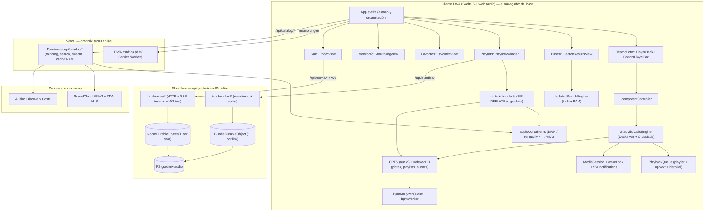

# GradMix — PWA de Mezcla Continua Auto-DJ, Catálogo en Streaming y Salas Colaborativas

**GradMix** es una Progressive Web App (PWA) de audio diseñada para operar como reproductor continuo de fiestas con transición **Auto-DJ (Equal-Power Crossfade)** en doble deck (`A` / `B`), biblioteca local persistente en **OPFS**, buscador aislado en memoria RAM conectado a catálogo remoto, exportación/importación en `.zip` estándar y salas colaborativas temporales en tiempo real.

Está pensada para **uso personal y grupos pequeños** — una fiesta, una reunión, una sala con amigos — no como plataforma de streaming masivo. Los límites concretos están en [Alcance del Proyecto](#alcance-del-proyecto).

---

## Tabla de Contenidos

1. [Stack Tecnológico](#stack-tecnológico)
2. [Alcance del Proyecto](#alcance-del-proyecto)
3. [Mapa de Arquitectura](#mapa-de-arquitectura)
4. [Módulos de la Aplicación](#módulos-de-la-aplicación)
5. [Estructura de Carpetas](#estructura-de-carpetas)
6. [Dónde Tocar Cada Cosa (Guía de Mantenimiento)](#dónde-tocar-cada-cosa-guía-de-mantenimiento)
7. [Endpoints HTTP, SSE y WebSocket (`gradmix-api` y `/api/catalog`)](#endpoints-http-sse-y-websocket-gradmix-api-y-apicatalog)
8. [Cómo Correr, Compilar y Probar la App](#cómo-correr-compilar-y-probar-la-app)
9. [Decisiones Técnicas y su Porqué](#decisiones-técnicas-y-su-porqué)
10. [Preguntas y Respuestas](#preguntas-y-respuestas)
11. [Glosario Técnico](#glosario-técnico)

---

## Stack Tecnológico

| Capa | Tecnología / Paquete | Uso en GradMix |
| :--- | :--- | :--- |
| **UI / Estado Reactivo** | **Svelte 5** (`^5.57.3`, runes `$state`, `$derived`, `$effect`) + **TypeScript** (`~6.0.3`) | Componentes desacoplados, estado centralizado en `App.svelte` y validación estática con `svelte-check`. |
| **Estilos** | **Tailwind CSS v4** (`^4.3.5`, `@tailwindcss/vite`) | Interfaz rectangular minimalista (`border-radius: 0`), modo **OLED oscuro** y **modo claro**. |
| **Empaquetador & PWA** | **Vite 8** (`^8.3.6`) + **vite-plugin-pwa** (`^2.0.0`, Workbox) | Compilación, caché offline (`sw.js`) e integración de manejador de notificaciones `sw-media-controls.js`. |
| **Motor de Audio** | **Web Audio API** + `<audio>` (`MediaElementAudioSourceNode`) + `AudioContext` | Doble deck (`A`/`B`), mezcla Equal-Power (`cos`/`sin`), compresor maestro y arranque rápido por streaming. |
| **Almacenamiento Local** | **OPFS** (`Origin Private File System`) + **IndexedDB** (`idb-keyval ^6.3.0`) | Audio binario almacenado en OPFS sin saturar RAM; metadatos, playlists y ajustes en IndexedDB. |
| **Análisis de BPM** | **Web Workers** (`bpmWorker.ts` / `bpmAnalyzer.ts`) + **web-audio-beat-detector** | Cola en segundo plano que detecta BPM y duración sin bloquear el hilo principal. |
| **Catálogo Remoto** | Funciones serverless de Vercel ([server/catalog.ts](gradmix-pwa/server/catalog.ts)) + plugin de Vite en dev ([vite-catalog-plugin.ts](gradmix-pwa/vite-catalog-plugin.ts)) | Proxy y caché de SoundCloud / Audius (`/api/catalog/*`) en el mismo origen del sitio. |
| **Backend de Salas y Links** | Worker de Cloudflare ([gradmix-api](gradmix-api)): Durable Objects + R2 | Salas en vivo (HTTP + SSE + WebSocket) y paquetes de playlist con audio, con TTL y autodestrucción. |
| **Contenedor Nativo** | **Capacitor** (`^8.6.2`) | Configuración base (`com.gradmix.app`, `webDir: dist`) en `capacitor.config.ts`. |
| **Pruebas** | **Node Test Runner** (`node --test tests/*.test.ts`) | Pruebas unitarias de cola, buscador recursivo, idempotencia, contenedores MP4/ADTS, tags ID3/MP4 y `.zip`. |

---

## Alcance del Proyecto

GradMix resuelve un problema concreto: **poner música en una fiesta con tu propia biblioteca y dejar que los invitados participen sin instalar nada**. Todas las decisiones siguientes se explican por ese objetivo.

### Lo que sí es

- Un reproductor **local-first**: la música vive en el navegador del host, no en un servidor.
- Un buscador de **catálogo público** (SoundCloud / Audius) para resolver "qué pongo ahora" sin salir de la app.
- Una forma de **compartir una playlist completa con audio** mediante un link temporal.
- Una **sala efímera** donde los invitados añaden pistas y controlan al host en tiempo real.

### Lo que no es

- **No compite con YouTube, Spotify o SnapTube.** No hay cuentas, catálogo propio, licencias, recomendaciones ni CDN de audio a escala.
- **No es multi-tenant ni elástico.** El estado de cada sala vive en un Durable Object y las cachés del catálogo en la memoria de cada instancia; no se comparten entre regiones.
- **No almacena audio de forma permanente.** Todo lo que sube al servidor caduca: los links a las 24 h y las salas al terminar su duración.
- **No tiene sistema de usuarios.** La identidad es un `participantId` local; no hay login, recuperación de cuenta ni historial en la nube.

### Límites reales

| Límite | Valor | Dónde se define |
| :--- | :--- | :--- |
| Duración de una sala | 0,25 h a 10 h; después expira y borra su audio | `MAX_ROOM_HOURS` en [shared.ts](gradmix-api/src/shared.ts) |
| Audio por pista subida | 35 MB | `MAX_UPLOAD_BYTES` en [shared.ts](gradmix-api/src/shared.ts) |
| Pistas por link de playlist | 300 | [bundle.ts](gradmix-api/src/bundle.ts) |
| Vida de un link de playlist | 24 h (luego se borra el audio de R2) | [bundle.ts](gradmix-api/src/bundle.ts) |
| Biblioteca local | La cuota que el navegador conceda al origen (uso típico: decenas de GB en escritorio, mucho menos en móvil) | OPFS |
| Concurrencia | Adecuada para grupos pequeños; sin *sharding* ni réplicas | Cloudflare Workers + DO |

**Costo**: con uso personal, todo cabe en los planes gratuitos de Vercel y Cloudflare. Al crecer, el primer cuello de botella es el almacenamiento de R2 (audio), después las invocaciones del Worker, y más tarde la cuota de OPFS en los dispositivos de los usuarios.

**Qué haría falta para escala tipo Spotify**: autenticación y cuentas, base de datos con índices y réplicas, almacenamiento de objetos con CDN y URLs firmadas, transcodificación por niveles, motor de recomendación, observabilidad y *rate limiting* por usuario. Nada de eso está aquí, y es deliberado: añadirlo multiplicaría el coste y la complejidad sin mejorar el caso de uso real.

---

## Mapa de Arquitectura

La aplicación sigue una arquitectura **local-first con estado unidireccional en frontend**, un **catálogo serverless en el propio sitio** y un **backend de salas en Cloudflare Workers**. En producción el sitio y el API viven en dominios distintos, pero el frontend solo usa rutas relativas:



**En desarrollo** (`npm run dev` + `npm run dev:api`) el diagrama es el mismo salvo dos detalles: el sitio lo sirve Vite en `:5173` y el Worker corre en `127.0.0.1:8787`, proxeado por Vite. No hay implementaciones paralelas.

### Flujos Críticos de Datos

1. **Reproducción de Baja Latencia (`GradMixAudioEngine.prepareDeckMedia`)**
   - Para archivos `> 1.5 MB`, el deck inicia directamente con `<audio src="blob:...">` conectado a `MediaElementAudioSourceNode`, evitando esperar `decodeAudioData()` completo antes de sonar.
   - El planificador (`setInterval` de 250 ms) pre-carga la siguiente pista ~25 s antes del final en el deck libre y dispara el **Crossfade Equal-Power** (`cos`/`sin`) cuando resta `crossfadeSeconds`.

2. **Normalización de Streams y Exportación `.m4a` + `.zip`**
   - Muchos streams HLS `audio/mp4` vienen como **fMP4** (`ftyp + moov(dur=0) + moof/mdat`), lo que provoca que reproductores de escritorio calculen duraciones erróneas (p. ej. centenas de horas).
   - `remuxFragmentedMp4ToStandardM4a()` reempaqueta el flujo sin recodificar el audio a un `.m4a` ISO-BMFF estándar (`ftyp M4A ` + `moov` completo con `mvhd`, `mdhd`, `stts`, `stsc`, `stsz`, `stco` + `mdat` único), tanto en el servidor (`/api/catalog/stream`) como al exportar `.zip` (`buildPlaylistZipBlob`).
   - `buildZipBlobFromEntries()` comprime cada canción individual usando `CompressionStream('deflate-raw')` (método `8` cuando reduce tamaño, respaldo `0` `STORE` en caso contrario).

3. **Cola Prioritaria ("Añadir a la cola")**
   - `PlaybackQueue.enqueueNext()` inserta pistas (locales o externas en RAM) en `upNextQueue`.
   - `peekNextTrackId()` y `advanceNext()` consumen primero `upNextQueue` en orden FIFO y, al vaciarse, reanudan la playlist exactamente en la posición siguiente (`resumePlaylistPos`).

4. **Buscador Aislado en RAM (`IsolatedSearchEngine`)**
   - Cero lecturas a IndexedDB/OPFS al teclear.
   - Normaliza acentos, mayúsculas/minúsculas y puntuación (`normalizeSearchText`) y puntúa de forma recursiva con memoización (`recursiveMatchTokens`, `recursiveSubsequenceScore`, `resolveCachedPrefixRecursive`).

5. **Controles fuera del navegador sin VAPID**
   - Combina **Media Session API** (`mediaSession.ts`) para controles nativos en pantalla de bloqueo / panel del SO + una notificación persistente local (`showNotification` vía `ServiceWorkerRegistration`) cuyos botones (`prev`, `toggle`, `next`, `close`) son capturados por [sw-media-controls.js](gradmix-pwa/public/sw-media-controls.js) y reenviados por `postMessage` a `App.svelte`.

6. **Sala colaborativa: el host reproduce, el Worker coordina**
   - El host abre un WebSocket (con SSE de respaldo) contra el Durable Object de la sala. Cada invitado escribe en el DO; el DO valida permisos, persiste el estado y reemite a todos.
   - El audio subido por invitados va a R2 y **el host lo descarga una sola vez**; a partir de ahí se marca `hasAudioRelay: false` y los demás no vuelven a bajarlo.
   - Los comandos (`toggle-play`, `skip-next`, `previous`) viajan como eventos; la reproducción real siempre ocurre en el dispositivo del host.

---

## Módulos de la Aplicación

Cada vista es un componente Svelte que recibe props y emite callbacks; **no hay store global**: `App.svelte` es el único dueño del estado y las vistas son presentacionales.

| Módulo | Qué hace | Cómo funciona | Archivos clave |
| :--- | :--- | :--- | :--- |
| **Reproductor** | Cola continua con mezcla entre canciones, sin silencios. | Doble deck (`A`/`B`) sobre Web Audio. Un planificador cada 250 ms precarga la siguiente pista en el deck libre y lanza el crossfade Equal-Power. Las pistas grandes se sirven por `<audio src="blob:">` para sonar al instante. | [audioEngine.ts](gradmix-pwa/src/lib/audio/audioEngine.ts), [queue.ts](gradmix-pwa/src/lib/utils/queue.ts), [PlayerDeck.svelte](gradmix-pwa/src/components/PlayerDeck.svelte) |
| **Buscar** | Encuentra pistas en tu biblioteca y en el catálogo público, y las añade a la cola o a una playlist. | Índice en RAM construido al arrancar; se teclea sobre memoria, sin tocar IndexedDB. Acepta coincidencias por subsecuencia y acentos. El catálogo remoto se pide a `/api/catalog/search`. | [searchEngine.ts](gradmix-pwa/src/lib/search/searchEngine.ts), [SearchResultsView.svelte](gradmix-pwa/src/components/SearchResultsView.svelte) |
| **Playlists** | Crear, renombrar, reordenar y compartir listas. | Playlists y orden en IndexedDB; el audio opcional vive en OPFS. Exporta `.zip` (o `.gradmix` con audio) para archivo local y genera un **link temporal** subiendo las pistas a R2 a través de `/api/bundles`. | [PlaylistManager.svelte](gradmix-pwa/src/components/PlaylistManager.svelte), [zip.ts](gradmix-pwa/src/lib/utils/zip.ts), [bundle.ts](gradmix-pwa/src/lib/utils/bundle.ts) |
| **Favoritos** | Marcar canciones y reproducirlas todas de una vez. | Es un booleano `favorite` dentro del registro de la pista; la vista filtra en memoria y "reproducir todo" crea una cola con esas pistas. No hay tabla aparte. | [FavoritesView.svelte](gradmix-pwa/src/components/FavoritesView.svelte), `handleToggleFavorite` en [App.svelte](gradmix-pwa/src/App.svelte) |
| **Monitoreo** | Ver cuánto espacio ocupa la biblioteca y limpiarla. | Consulta `navigator.storage.estimate()` para uso/cuota de OPFS, muestra el estado de los decks y ofrece vaciado completo (audio + metadatos) con confirmación. | [MonitoringView.svelte](gradmix-pwa/src/components/MonitoringView.svelte), [opfsStorage.ts](gradmix-pwa/src/lib/storage/opfsStorage.ts) |
| **Sala** | Fiesta colaborativa: invitados añaden pistas y controlan al host. | El host crea la sala con código y clave; los invitados entran con código+clave o link con `inviteToken`. El anfitrión concede permisos (`canSkip`, `canPause`, `canAdd`, `canRemove`). Todo se sincroniza por WebSocket/SSE contra un Durable Object. | [RoomView.svelte](gradmix-pwa/src/components/RoomView.svelte), [room.ts](gradmix-api/src/room.ts), [index.ts](gradmix-api/src/index.ts) |

---

## Estructura de Carpetas

```text
DjARC/
├── capacitor.config.json          # Metadatos Capacitor en raíz
├── docs/                          # Material de diseño, imágenes y guía de despliegue
├── package.json                   # Dependencias compartidas en raíz
├── gradmix-api/                   # Worker de Cloudflare: salas y links de playlist
│   ├── src/index.ts               # Router, CORS y creación de códigos
│   ├── src/room.ts                # RoomDurableObject (SSE, WebSocket, audio en R2)
│   ├── src/bundle.ts              # BundleDurableObject (paquetes con TTL 24 h)
│   ├── src/shared.ts              # Tipos, PBKDF2 y utilidades
│   ├── scripts/smoke.mjs          # 36 comprobaciones end-to-end del API
│   └── wrangler.jsonc             # Bindings, migraciones y dominio api.gradmix.*
└── gradmix-pwa/                   # Aplicación principal (Vite + Svelte + PWA)
    ├── vite.config.ts             # Plugins Tailwind, Svelte, gradmixCatalogPlugin, VitePWA y proxy al Worker
    ├── vite-catalog-plugin.ts     # Middleware de /api/catalog/* en dev/preview
    ├── server/catalog.ts          # Lógica de catálogo compartida con Vercel
    ├── server/api/catalog/*.ts    # Entradas de las funciones serverless
    ├── scripts/build-api.mjs      # Empaqueta las funciones en api/*.js para Vercel
    ├── capacitor.config.ts        # Configuración Capacitor (com.gradmix.app -> dist/)
    ├── package.json               # Scripts: dev, dev:api, build, preview, check
    ├── public/
    │   ├── manifest.json          # Manifiesto PWA instalable
    │   ├── sw-media-controls.js   # Listener notificationclick en SW para controles multimedia locales
    │   └── icons/                 # Íconos PWA (192, 512, maskable)
    ├── tests/                     # Suite de pruebas unitarias (node:test)
    │   ├── audioContainer.test.ts
    │   ├── audioTagsAndFormats.test.ts
    │   ├── idempotency.test.ts
    │   ├── queue.test.ts
    │   ├── search.test.ts
    │   └── zip.test.ts
    └── src/
        ├── App.svelte             # Orquestador principal de estado, efectos, OPFS/IDB y vistas
        ├── app.css                # Tailwind v4 + variantes de tema y estilos globales rectangulares
        ├── main.ts                # Punto de entrada de montaje Svelte
        ├── components/            # Módulos visuales de UI
        │   ├── SidebarNav.svelte          # Menú lateral / hamburguesa móvil
        │   ├── PlayerDeck.svelte          # Vista principal del reproductor + decks + favoritos/playlist
        │   ├── BottomPlayerBar.svelte     # Barra inferior colapsable (título, play/pause, siguiente, cola)
        │   ├── CrossfadeControl.svelte    # Selector 4s/8s/12s y switch Auto-DJ
        │   ├── PlaylistManager.svelte     # CRUD playlists, carga múltiple, orden, envío WhatsApp y .zip/link
        │   ├── SearchResultsView.svelte   # Página "Coincidencias" (locales + catálogo + añadir a cola/playlist)
        │   ├── FavoritesView.svelte       # Lista y reproducción rápida de favoritas
        │   ├── MonitoringView.svelte      # Uso de cuota OPFS/RAM, decks en vivo y vaciado de base local
        │   ├── RoomView.svelte            # Sala colaborativa temporal (Host/Invitado, permisos, subida)
        │   ├── BlackoutOverlay.svelte     # Modo "Ahorro de batería" AMOLED/negro con controles mínimos
        │   └── ConfirmModal.svelte        # Modal reutilizable de confirmación
        └── lib/
            ├── types.ts                   # Contratos e interfaces globales del dominio
            ├── api/
            │   └── audius.ts              # Cliente HTTP hacia /api/catalog/* y validación de descarga
            ├── audio/
            │   ├── audioEngine.ts         # Motor dual-deck Web Audio + streaming + crossfade
            │   ├── audioContainer.ts      # Detección DRM/contenedores, extractor ADTS y remuxer fMP4->M4A
            │   ├── mediaSession.ts        # Metadata y handlers MediaSession del navegador
            │   └── wakeLock.ts            # Wrapper Wake Lock API para evitar suspensión de pantalla
            ├── search/
            │   └── searchEngine.ts        # Motor aislado recursivo en RAM y caché de prefijos
            ├── storage/
            │   ├── db.ts                  # Persistencia IndexedDB (tracks, playlists, settings)
            │   └── opfsStorage.ts         # Lectura/escritura de blobs en OPFS + fallback IndexedDB
            ├── utils/
            │   ├── audioTags.ts           # Lectura de etiquetas ID3v2 y átomos MP4 (título/artista)
            │   ├── bundle.ts              # Construcción de .zip de playlist y paquetes binarios .gradmix
            │   ├── format.ts              # Formateo de tiempos, limpieza de títulos y MIME soportados
            │   ├── idempotency.ts         # IdempotentController y claves de idempotencia
            │   ├── queue.ts               # PlaybackQueue (orden, shuffle, repeat, historial, upNextQueue)
            │   ├── whatsapp.ts            # Generación de enlaces wa.me para playlists/salas
            │   └── zip.ts                 # Constructor/lector .zip estándar (DEFLATE vía CompressionStream)
            └── workers/
                ├── bpmAnalyzer.ts         # Gestor de cola secuencial para análisis de BPM en segundo plano
                └── bpmWorker.ts           # Web Worker de cálculo de BPM
```

---

## Dónde Tocar Cada Cosa (Guía de Mantenimiento)

| Si necesitas modificar... | Archivo(s) principal(es) | Símbolos / Secciones clave |
| :--- | :--- | :--- |
| **Navegación general, temas, modales globales o flujo de reproducción** | [App.svelte](gradmix-pwa/src/App.svelte) | `handleSelectAudiusTrack`, `playLibraryTrack`, `handleQueueNextLocalTrack`, `handleAddTrackToChosenPlaylist`, `$effect` de `engine.syncLibrary` (envuelto en `untrack`). |
| **Motor de mezcla, crossfade o velocidad de arranque** | [audioEngine.ts](gradmix-pwa/src/lib/audio/audioEngine.ts) | `GradMixAudioEngine`, `prepareDeckMedia`, `executeCrossfade`, `enqueueNext`, `runSchedulerTick`. |
| **Orden de reproducción, modo aleatorio o cola "Siguiente"** | [queue.ts](gradmix-pwa/src/lib/utils/queue.ts) | `PlaybackQueue` (`setPlaylistOrder`, `enqueueNext`, `peekNextTrackId`, `advanceNext`, `stepPrevious`, `getAnchorIndexForNext`). |
| **Barra inferior desplegable (título, pausa, siguiente, cola)** | [BottomPlayerBar.svelte](gradmix-pwa/src/components/BottomPlayerBar.svelte) | Props `upNextTracks`, `hasPlaylistInPlayback`, `onRequestAddToPlaylist`. |
| **Reproductor principal y controles de transporte** | [PlayerDeck.svelte](gradmix-pwa/src/components/PlayerDeck.svelte) | Botones de transporte, barra seek, favoritos y botón de añadir a playlist. |
| **Playlists (subida, renombrado, envío por WhatsApp, `.zip` y links)** | [PlaylistManager.svelte](gradmix-pwa/src/components/PlaylistManager.svelte) | `onExportBundleFile`, `onExportBundleLink`, `onImportFromFile`, `onImportFromLink`, `onQueueNextTrack`. |
| **Favoritos (marcar, listar, reproducir todo)** | [FavoritesView.svelte](gradmix-pwa/src/components/FavoritesView.svelte) y [App.svelte](gradmix-pwa/src/App.svelte) | `handleToggleFavorite`, `handlePlayAllFavorites`, `favoriteTracks` (`$derived` sobre `tracks`). |
| **Compresión `.zip` y lectura/extracción `.zip`** | [zip.ts](gradmix-pwa/src/lib/utils/zip.ts) y [bundle.ts](gradmix-pwa/src/lib/utils/bundle.ts) | `buildZipBlobFromEntries`, `parsePlaylistZipFile`, `buildPlaylistZipBlob`, `buildGradmixBundleBlob`. |
| **Reparación de `.m4a` fragmentados, filtros DRM o formatos** | [audioContainer.ts](gradmix-pwa/src/lib/audio/audioContainer.ts) y [format.ts](gradmix-pwa/src/lib/utils/format.ts) | `inspectAudioContainer`, `remuxFragmentedMp4ToStandardM4a`, `extractAdtsFromFragmentedMp4`, `orderSoundCloudTranscodings`. |
| **Buscador instantáneo (local + catálogo)** | [searchEngine.ts](gradmix-pwa/src/lib/search/searchEngine.ts) y [SearchResultsView.svelte](gradmix-pwa/src/components/SearchResultsView.svelte) | `IsolatedSearchEngine`, `normalizeSearchText`, `recursiveSubsequenceScore`. |
| **Catálogo SoundCloud/Audius y cachés de streaming** | [server/catalog.ts](gradmix-pwa/server/catalog.ts) | `createCatalogHandler`, `resolveSoundCloudClientId`, `streamSoundCloudFullTrack`, `searchSoundCloudCatalog`. |
| **Salas colaborativas, permisos y links de playlist** | [gradmix-api/src/index.ts](gradmix-api/src/index.ts), [room.ts](gradmix-api/src/room.ts), [bundle.ts](gradmix-api/src/bundle.ts) | `RoomDurableObject`, `BundleDurableObject`, `handleJoin`, `handleTrackUpload`, `handleTrackAudio`. |
| **Almacenamiento OPFS / IndexedDB y monitoreo de cuota** | [opfsStorage.ts](gradmix-pwa/src/lib/storage/opfsStorage.ts), [db.ts](gradmix-pwa/src/lib/storage/db.ts), [MonitoringView.svelte](gradmix-pwa/src/components/MonitoringView.svelte) | `saveAudioFile`, `readAudioBlob`, `getStorageUsage`, `clearAllAudioFiles`. |
| **Notificaciones locales y MediaSession (sin VAPID)** | [mediaSession.ts](gradmix-pwa/src/lib/audio/mediaSession.ts) y [sw-media-controls.js](gradmix-pwa/public/sw-media-controls.js) | `registerMediaSessionHandlers`, `updateMediaSessionMetadata`, evento `notificationclick` en SW. |
| **Bloqueos anti doble clic / peticiones idempotentes** | [idempotency.ts](gradmix-pwa/src/lib/utils/idempotency.ts) | `IdempotentController` (`run`, `minLockMs`). |

---

## Endpoints HTTP, SSE y WebSocket (`gradmix-api` y `/api/catalog`)

El API tiene dos piezas con ciclos de vida distintos:

| Ruta | Dónde vive en producción | Dónde vive en desarrollo |
| :--- | :--- | :--- |
| `/api/catalog/*` | Funciones serverless de Vercel (mismo origen del sitio) | [vite-catalog-plugin.ts](gradmix-pwa/vite-catalog-plugin.ts) |
| `/api/rooms/*`, `/api/bundles/*` | Worker `gradmix-api` → `https://api.gradmix.arc03.online` | El mismo Worker en local (`npm run dev:api`), proxeado por Vite a `127.0.0.1:8787` |

El frontend siempre usa rutas relativas (`apiUrl()` en [base.ts](gradmix-pwa/src/lib/api/base.ts)): en desarrollo Vite las proxea al Worker local y en producción `VITE_API_BASE` apunta al Worker desplegado. **No hay dos implementaciones**: lo que pruebas en local es el mismo código que corre en Cloudflare.

### Catálogo Remoto (`/api/catalog/*`)
- `GET /api/catalog/trending?limit=16`: devuelve pistas populares (priorizando catálogo SoundCloud y respaldo Audius) con caché TTL en servidor.
- `GET /api/catalog/search?q=<texto>&limit=24`: busca canciones por título/artista con caché LRU/TTL de búsquedas.
- `GET /api/catalog/stream?trackId=<id>&host=<opcional>`: descarga/ensambla el stream completo, descarta pistas cifradas con DRM, remuxa `fMP4 -> .m4a` estándar si aplica y lo cachea en RAM temporal para acelerar repeticiones.

### Empaquetado Temporal de Playlists por Enlace (`/api/bundles`)
- `POST /api/bundles`: crea el manifiesto del paquete y devuelve un `id` temporal para compartir por URL (`?import=...`).
- `POST /api/bundles/:id/tracks/:index`: sube el audio de cada pista a R2 (35 MB por pista, hasta 300).
- `GET /api/bundles/:id`: devuelve el manifiesto; `GET /api/bundles/:id/tracks/:index` descarga el audio.
- Todo el paquete expira y se borra de R2 a las 24 h.

### Salas Colaborativas Temporales (`/api/rooms/*`)
- `POST /api/rooms`: crea una sala temporal (0,25 h a 10 h, código personalizable).
- `GET /api/rooms/:code?participantId=...`: consulta el estado público actual de la sala.
- `DELETE /api/rooms/:code`: cierra la sala (solo host); borra su audio de R2.
- `POST /api/rooms/:code/join`: une a un invitado mediante clave o `inviteToken`.
- `POST /api/rooms/:code/permissions`: actualiza privilegios granulares (`canSkip`, `canPause`, `canAdd`, `canRemove`).
- `POST /api/rooms/:code/tracks`, `GET /api/rooms/:code/tracks/:id/audio`, `DELETE /api/rooms/:code/tracks/:id`: cola compartida. El host descarga el audio **una sola vez**; después se marca `hasAudioRelay: false`.
- `POST /api/rooms/:code/command` y `POST /api/rooms/:code/state`: comandos remotos (`toggle-play`, `skip-next`, `previous`) y sincronización del host.
- `GET /api/rooms/:code/events` (**SSE**) y `WS /api/rooms/:code/ws` (**WebSocket**): participantes, privilegios, pistas, estado y comandos en tiempo real.

La verificación automática de todo esto vive en [gradmix-api/scripts/smoke.mjs](gradmix-api/scripts/smoke.mjs).

---

## Cómo Correr, Compilar y Probar la App

> **Importante:** Todos los scripts de Vite y pruebas viven dentro de la carpeta `gradmix-pwa/`.

### 1. Instalar dependencias
```powershell
cd gradmix-pwa
npm install
```

### 2. Modo Desarrollo (HMR / recarga en caliente)
```powershell
cd gradmix-api
npm run dev          # Worker en http://127.0.0.1:8787 (salas y links)

cd ../gradmix-pwa
npm run dev          # App en http://localhost:5173
```
- `npm run dev:api` desde `gradmix-pwa/` levanta el Worker sin cambiar de carpeta.
- Vite proxea `/api/rooms` y `/api/bundles` a `127.0.0.1:8787`, así que el navegador ve un solo origen.
- Si el Worker no está corriendo, las salas y los links fallan con error de red; el resto de la app (UI, OPFS, catálogo) funciona igual.
- Disponible en `http://localhost:5173` y en tu IP de red local (`server.host: true`).
- En este modo el Service Worker PWA permanece desactivado (`devOptions.enabled: false`).

### 3. Modo Producción / PWA (`build` + `preview`)
```powershell
cd gradmix-pwa
npm run build
npm run preview
```
- `vite build` genera la aplicación optimizada y el Service Worker en `gradmix-pwa/dist/`.
- `vite preview` levanta la PWA completa con Service Worker y `/api/*` en `http://localhost:4173` (proxea salas/links al Worker local, sirve el catálogo con el plugin).

### 4. Exponer por HTTPS para probar PWA / móviles (`cloudflared`)
Las APIs de PWA instalable, OPFS persistente y `WakeLock` requieren contexto seguro (`https://` o `localhost`). Para probar desde un celular en red externa:
```powershell
cloudflared tunnel --url http://127.0.0.1:4173
```

### 5. Chequeo de tipos y pruebas unitarias
```powershell
cd gradmix-pwa
npm run check
node --test tests/*.test.ts
```

### 6. Sincronización nativa opcional (Capacitor)
```powershell
cd gradmix-pwa
npm run build
npx cap sync
```

---

## Decisiones Técnicas y su Porqué

Cada decisión incluye el motivo y, cuando aplica, el coste que aceptamos a cambio.

### Producto y arquitectura

- **Local-first, sin cuentas.** La biblioteca vive en el dispositivo del host: no hay subida masiva, no hay login y la app abre sin red. Coste aceptado: si el usuario limpia los datos del navegador, pierde su música (de ahí la exportación `.zip`).
- **Dos backends con ciclos de vida distintos.** El catálogo es HTTP sin estado y se cachea bien en funciones serverless de Vercel (mismo origen del sitio, cero CORS). Las salas necesitan estado consistente, WebSocket y almacenamiento de objetos, y eso encaja mejor en un Worker con Durable Objects + R2. Coste: dos despliegues en lugar de uno.
- **Un solo backend en desarrollo.** Vite proxea `/api/rooms` y `/api/bundles` al Worker local en vez de reimplementarlos. Se eliminaron ~1.500 líneas duplicadas. Coste: hay que arrancar el Worker (`npm run dev:api`) para probar salas.
- **Svelte 5 en vez de React.** Se compila a JavaScript imperativo sin runtime de reconciliación, lo que importa en un dispositivo reproduciendo audio. Las runas (`$state`, `$derived`, `$effect`) sustituyen a los stores. Coste: menos ecosistema de componentes; la UI es propia.
- **Cuidado con los bucles reactivos.** El `$effect` que llama a `engine.syncLibrary()` lee `engineSnapshot.currentTrackId` dentro de `untrack()` porque `syncLibrary` vuelve a emitir el snapshot; sin eso, Svelte lanzaría `effect_update_depth_exceeded`. Es el patrón a respetar al tocar `App.svelte`.
- **Tailwind v4 sin kit de componentes.** Interfaz rectangular a medida, CSS pequeño y control total del modo OLED. Coste: más markup escrito a mano.

### Audio

- **Streaming antes que decodificar.** Para pistas de más de 1.5 MB, el deck arranca con `<audio src="blob:">` y `decodeAudioData()` queda como respaldo. Decodificar 8 MB en un móvil son segundos de espera antes del primer sonido. Coste: se pierde el análisis PCM previo en esas pistas.
- **Remux, no recodificación.** `remuxFragmentedMp4ToStandardM4a()` reescribe contenedores y cabeceras sin tocar las muestras AAC: corrige duraciones absurdas de fMP4 y mantiene la calidad bit a bit. Coste: implementación propia y sensible al formato de origen.
- **Crossfade Equal-Power con dos decks.** `cos`/`sin` mantienen la energía percibida constante durante la transición; un solo elemento `<audio>` no permite solapar dos canciones. Coste: dos fuentes de audio y un planificador que debe precargar a tiempo.
- **BPM en un Web Worker.** El análisis es costoso y bloquea el hilo principal; se mueve a una cola secuencial en segundo plano. Coste: el BPM no está disponible en el instante en que se añade la pista.

### Datos

- **OPFS para audio, IndexedDB para metadatos.** Los binarios no caben en IndexedDB sin degradar el rendimiento, y OPFS está pensado para archivos grandes. IndexedDB sigue siendo cómodo para consultar pistas, playlists y ajustes. Coste: dos mecanismos de persistencia que hay que mantener coherentes (con respaldo de IDB si OPFS falla).
- **Sin base de datos en el servidor.** Nada del catálogo ni de la biblioteca se guarda en backend; lo que se persiste es efímero (salas y links) y vive en el storage del Durable Object o en R2. Coste: no hay historial entre dispositivos.
- **Aviso al 80% de cuota.** `App.svelte` vigila `storagePercent` y avisa antes de que el navegador rechace escrituras; Monitoreo ofrece el vaciado completo. Coste: el umbral es heurístico, no una garantía de que quede espacio.
- **Idempotencia en el cliente.** `IdempotentController` bloquea por clave de operación para que un doble toque no cree dos salas ni suba dos veces la misma pista. Coste: una capa extra de estado en `App.svelte`.
- **Exportación `.zip` estándar.** Formatos abiertos garantizan que el usuario pueda sacar su música a cualquier reproductor. `CompressionStream('deflate-raw')` evita dependencias de compresión. Coste: comprimir en el hilo de UI (se hace por canciones, no de golpe).

### Infraestructura

- **Durable Objects para las salas.** Un DO por sala serializa las escrituras (permisos, cola, comandos) sin condiciones de carrera y mantiene el WebSocket en un único punto. KV es eventualmente consistente y D1 añadiría esquema y operación para datos que duran horas. Coste: acoplarse a Cloudflare y pagar por duración de DO.
- **R2 en lugar de retransmitir audio por el Worker.** El host descarga el audio una sola vez y el resto de la sala no lo vuelve a pedir. Un Worker tiene 128 MB de memoria y no debe proxyar archivos de 35 MB. Coste: el primer ingreso lo paga el host.
- **TTL con alarmas del Durable Object.** Salas y links se autodestruyen solos: no hace falta un cron de limpieza ni una tabla de expirados. Coste: si la alarma falla, el objeto queda huérfano hasta la siguiente lectura.
- **PBKDF2-SHA256 a 12.000 iteraciones.** Disponible en WebCrypto sin dependencias WASM, suficiente para una clave de sala que vive 10 h como máximo. No se usa para contraseñas de cuentas porque no existen cuentas. Coste: si algún día hay credenciales reales, habrá que subir el coste o cambiar a Argon2.
- **Sin VAPID ni servidor Push.** Media Session + una notificación local del Service Worker dan los controles en pantalla de bloqueo sin gestionar suscripciones. Coste: no hay notificaciones si la app está completamente cerrada.
- **Cachés en memoria en `/api/catalog`.** Evitan quemar el rate limit de SoundCloud y aceleran repeticiones. Coste: cada instancia tiene su propia caché (sin invalidación global) y el primer request tras un arranque en frío es lento.

### Alternativas descartadas

- **Firebase / Supabase** para salas: exigirían cuentas, reglas de seguridad y un esquema para datos que caducan en horas. El Durable Object ya da consistencia y WebSocket.
- **Next.js**: GradMix es una SPA con dos funciones serverless; el framework añadiría servidor, routing y peso sin resolver nada del caso de uso.
- **Un servidor Node propio** (el antiguo plugin de Vite): no escala a cero, exige mantener una máquina y duplicaba el backend real.
- **App nativa con Capacitor**: la configuración existe, pero la PWA cubre el objetivo y evita publicar en tiendas. Es una vía abierta, no el camino principal.

---

## Preguntas y Respuestas

**¿Necesito crear una cuenta?**
No. No hay registro ni login; tu identidad en una sala es un identificador generado en el navegador.

**¿Dónde se guarda mi música?**
En tu dispositivo, en el almacenamiento privado del navegador (OPFS + IndexedDB). No se sube a ningún servidor salvo que compartas un link de playlist o una sala, y en ese caso caduca.

**¿Qué pasa si borro los datos del navegador?**
Se pierde la biblioteca local. Exporta tus playlists a `.zip` antes de limpiar el sitio o de cambiar de dispositivo.

**¿Por qué una canción del catálogo dura 300 horas o no suena?**
Suele ser un stream `fMP4` con la duración mal declarada o una pista con DRM. El backend descarta las cifradas y remuxa las fragmentadas a `.m4a` estándar; si aun así falla, la pista no es reproducible.

**¿La sala sigue sonando si el host cierra el móvil?**
No. El anfitrión es quien reproduce; la sala y su cola siguen existiendo hasta que expira, pero sin host no hay audio. Al volver, retoma el estado guardado en el Durable Object.

**¿Funciona sin internet?**
La interfaz, tu biblioteca local y la reproducción sí (Service Worker + OPFS). El catálogo remoto, los links de playlist y las salas necesitan conexión.

**¿Funciona en iPhone?**
Sí para reproducir y entrar a salas, pero iOS es más agresivo liberando almacenamiento: instala la PWA en la pantalla de inicio y mantén un `.zip` de respaldo.

**¿Es legal descargar música de SoundCloud o Audius con esto?**
GradMix no aloja catálogo: reproduce mediante las APIs públicas de cada servicio. Úsalo con contenido al que tengas derecho y respeta sus términos; la responsabilidad del uso es del usuario.

**¿Cuánto cuesta mantenerlo?**
Con uso personal, los planes gratuitos de Vercel y Cloudflare son suficientes. El primer gasto real sería el almacenamiento de audio en R2 si se comparten links grandes con frecuencia.

---

## Glosario Técnico

- **OPFS (`Origin Private File System`):** Sistema de archivos privado por origen del navegador optimizado para leer/escribir binarios grandes en disco sin cargar toda la biblioteca en RAM.
- **fMP4 (Fragmented MP4):** Variante de MP4 usada en HLS donde la duración global en `mvhd` suele venir en `0` y las muestras se reparten en pares `moof` + `mdat`.
- **Remuxing (`fMP4 -> .m4a` estándar):** Reempaquetado de contenedores sin recomprimir los frames AAC, reconstruyendo `moov` y un único `mdat` para compatibilidad total con reproductores de escritorio y móviles.
- **Equal-Power Crossfade:** Curva de mezcla por ganancias $\cos(\theta)$ y $\sin(\theta)$ que mantiene constante la energía percibida durante la transición entre Deck A y Deck B.
- **Idempotency Controller (`IdempotentController`):** Controlador de bloqueos por clave de operación que descarta dobles clics/taps rápidos mientras una operación sigue en curso.
- **Up-Next Queue (`enqueueNext`):** Cola prioritaria FIFO independiente de la playlist activa que reproduce pistas inmediatamente después de la canción en curso y luego retoma la playlist.
- **MediaSession + SW Notifications (sin VAPID):** Integración local del SO que permite controlar Play/Pause, Siguiente y Anterior desde la barra de notificaciones o pantalla bloqueada sin servidor Push ni claves VAPID.
- **Wake Lock (`Screen Wake Lock API`):** Bloqueo temporal que impide que la pantalla del dispositivo se apague durante la reproducción o en **Ahorro de batería**.
- **ZIP DEFLATE / STORE:** Métodos `8` (compresión zlib sin cabecera / RFC 1951 vía `CompressionStream('deflate-raw')`) y `0` (almacenamiento sin compresión cuando los datos no comprimen más).
