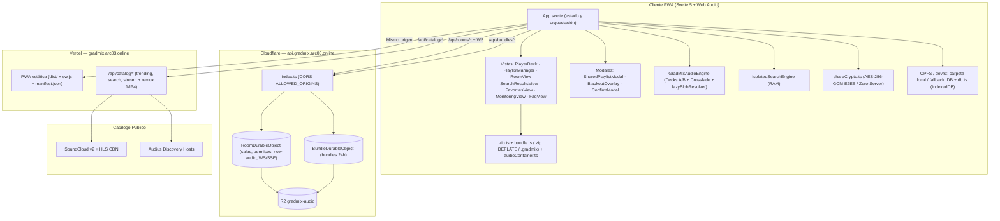

<div align="center">

# GradMix

**PWA Open Source de Auto-DJ Offline, Catálogo en Streaming, Enlaces Cifrados E2EE y Salas Colaborativas**

[](https://github.com/aruiz3122004/DjARC)
[](https://gradmix.arc03.online)
[](gradmix-pwa/package.json)
[](gradmix-api/wrangler.jsonc)
[](docs/WIKI.md)

[Demo en Vivo](https://gradmix.arc03.online) · [Inicio Rápido](#inicio-rápido-en-local) · [Barra de Búsqueda](#barra-de-búsqueda-rápida-en-github) · [Wiki del Repositorio](#wiki-del-repositorio) · [Glosario](#glosario-técnico)

</div>

> **GradMix** mezcla música continua sin silencios con doble deck (`A`/`B`), crossfade **Equal-Power**, biblioteca offline en **OPFS** o carpeta real (`devfs::`), compartición cifrada **E2EE** por WhatsApp y salas temporales en tiempo real — sin cuentas, sin login y pensada para fiestas y grupos pequeños.

---

## Barra de Búsqueda Rápida en GitHub

> GitHub elimina formularios `<input>` y scripts en `README.md` por seguridad. Para encontrar cualquier archivo, endpoint o símbolo **sin hacer scroll**:

- **Atajos de teclado en GitHub:** pulsa **`/`** para abrir la barra de búsqueda del repositorio, **`t`** para saltar directo a cualquier archivo por nombre, o **`Ctrl + F`** (`⌘ + F`) tras abrir el acordeón de interés.
- **Búsquedas directas prefiltradas en este repositorio:**

| Qué quieres encontrar | Búsqueda directa en GitHub | Archivo o Doc clave |
| :--- | :--- | :--- |
| **Motor de Audio, Crossfade y Colas** | [Buscar en `lib/audio` y `queue.ts`](https://github.com/aruiz3122004/DjARC/search?q=path%3Agradmix-pwa%2Fsrc%2Flib%2Faudio+OR+path%3Aqueue.ts) | [`audioEngine.ts`](gradmix-pwa/src/lib/audio/audioEngine.ts) · [`MODULOS-UI-OV.md`](docs/MODULOS-UI-OV.md) |
| **Salas en Vivo, WebSocket y Heartbeat** | [Buscar en `gradmix-api` y `RoomView`](https://github.com/aruiz3122004/DjARC/search?q=path%3Agradmix-api+OR+path%3ARoomView.svelte) | [`room.ts`](gradmix-api/src/room.ts) · [`SALAS-Y-COMPARTICION-OV.md`](docs/SALAS-Y-COMPARTICION-OV.md) |
| **Cifrado WhatsApp E2EE (`?import=#k=` / `?share=`)** | [Buscar `shareCrypto` y `SharedPlaylistModal`](https://github.com/aruiz3122004/DjARC/search?q=shareCrypto+OR+SharedPlaylistModal) | [`shareCrypto.ts`](gradmix-pwa/src/lib/utils/shareCrypto.ts) · [`SALAS-Y-COMPARTICION-OV.md`](docs/SALAS-Y-COMPARTICION-OV.md) |
| **Almacenamiento OPFS, `devfs::` e IndexedDB** | [Buscar `opfsStorage` y `devfs`](https://github.com/aruiz3122004/DjARC/search?q=opfsStorage+OR+devfs) | [`opfsStorage.ts`](gradmix-pwa/src/lib/storage/opfsStorage.ts) · [`ALMACENAMIENTO-Y-SEGURIDAD-OV.md`](docs/ALMACENAMIENTO-Y-SEGURIDAD-OV.md) |
| **Catálogo SoundCloud / Audius y Remux `fMP4`** | [Buscar `catalog` y `remux`](https://github.com/aruiz3122004/DjARC/search?q=path%3Aserver%2Fcatalog.ts+OR+remuxFragmentedMp4ToStandardM4a) | [`server/catalog.ts`](gradmix-pwa/server/catalog.ts) · [`audioContainer.ts`](gradmix-pwa/src/lib/audio/audioContainer.ts) |

---

## Wiki del Repositorio

Este proyecto sigue el enfoque **Docs-as-Code**: toda la Wiki vive versionada en Git dentro de [`docs/`](docs/) para mantenerse 100% sincronizada con el código, con posibilidad de espejarse en la pestaña [**GitHub Wiki**](https://github.com/aruiz3122004/DjARC/wiki).

| Página Wiki (`-OV`) | Contenido |
| :--- | :--- |
| [**Wiki Home (`docs/WIKI.md`)**](docs/WIKI.md) | Índice maestro de la documentación técnica y guía de sincronización Wiki |
| [**Arquitectura General (`docs/ARQUITECTURA-OV.md`)**](docs/ARQUITECTURA-OV.md) | Topología PWA ↔ Vercel ↔ Cloudflare Workers/DO/R2, paridad dev/prod y flujo de catálogo |
| [**Módulos UI y Motor (`docs/MODULOS-UI-OV.md`)**](docs/MODULOS-UI-OV.md) | Estado en `App.svelte`, 14 componentes Svelte 5, `GradMixAudioEngine`, `PlaybackQueue` y PWA |
| [**Salas y Compartición (`docs/SALAS-Y-COMPARTICION-OV.md`)**](docs/SALAS-Y-COMPARTICION-OV.md) | `RoomDurableObject`, latidos anti-hibernación, `now-audio` y WhatsApp E2EE (`?share=` / `#k=`) |
| [**Almacenamiento y Seguridad (`docs/ALMACENAMIENTO-Y-SEGURIDAD-OV.md`)**](docs/ALMACENAMIENTO-Y-SEGURIDAD-OV.md) | 3 capas (`IndexedDB`, `OPFS`, `devfs::`), remux `.m4a`, `.zip`/`.gradmix` y modelo de amenazas |
| [**Guía de Despliegue (`docs/DEPLOY_GRADMIX.md`)**](docs/DEPLOY_GRADMIX.md) | Runbook de Vercel (`gradmix.arc03.online`), Cloudflare Worker (`api.gradmix.arc03.online`) y R2 |

<details>
<summary><strong>Cómo reflejar esta documentación en la pestaña Wiki de GitHub (opcional)</strong></summary>

1. En GitHub, abre **Settings → Features** y habilita **Wikis** en el repositorio `aruiz3122004/DjARC`.
2. Clona el repositorio Wiki aparte (`git clone https://github.com/aruiz3122004/DjARC.wiki.git`).
3. Copia [`docs/WIKI.md`](docs/WIKI.md) como `Home.md` junto a `docs/*-OV.md` y `docs/DEPLOY_GRADMIX.md`, y haz `git push`.

</details>

---

## Inicio Rápido en Local

**Requisito:** Node.js 20+. Instala dependencias en `gradmix-pwa/` (obligatorio) y `gradmix-api/` (necesario solo para Salas y Links E2EE locales):

```powershell
# Terminal 1 — Worker local de Salas y Bundles (http://127.0.0.1:8787)
cd gradmix-api; npm install; npm run dev

# Terminal 2 — Frontend PWA con HMR + catálogo (http://localhost:5173)
cd gradmix-pwa; npm install; npm run dev
```

> Puedes levantar el Worker sin cambiar de carpeta ejecutando `npm run dev:api` dentro de `gradmix-pwa/`. Deja `VITE_API_BASE` vacío en local ([`.env.example`](gradmix-pwa/.env.example)) para usar el proxy de Vite.

---

## Documentación Compacta (Acordeones)

> Haz clic en cualquier bloque para desplegar la información técnica sin llenar tu pantalla.

<details>
<summary><strong>1. Stack Tecnológico y Límites Reales del Sistema</strong> — Svelte 5, Web Audio, OPFS/devfs::, Workers/DO/R2</summary>

### Stack Tecnológico

| Capa | Tecnología / Paquete | Uso en GradMix |
| :--- | :--- | :--- |
| **UI / Estado** | **Svelte 5** (`^5.57.3`, runas) + **TypeScript** (`~6.0.3`) | Componentes desacoplados, estado único en `App.svelte` y `svelte-check`. |
| **Estilos** | **Tailwind CSS v4** (`^4.3.5`) | Diseño rectangular minimalista (`border-radius: 0`), tema oscuro OLED y claro. |
| **Empaquetador & PWA** | **Vite 8** (`^8.3.6`) + **vite-plugin-pwa** (`^2.0.0`) | Bundle, Service Worker offline (`sw.js`, `manifest.json`) y notificaciones locales. |
| **Motor de Audio** | **Web Audio API** + `<audio>` (`MediaElementAudioSourceNode`) | Doble deck (`A`/`B`), mezcla Equal-Power (`cos`/`sin`) y streaming rápido. |
| **Almacenamiento** | **OPFS** + **IndexedDB** (`idb-keyval ^6.3.0`) + **File System Access** (`devfs::`) | Binarios en OPFS o carpeta local elegida; metadatos/playlists en IndexedDB. |
| **Criptografía** | **WebCrypto API** (`AES-256-GCM`, `PBKDF2-SHA256`) | Cifrado E2EE de links (`#k=`) y hashing de contraseñas de sala (`12_000` iters). |
| **BPM** | **Web Workers** + **web-audio-beat-detector** | Cola secuencial en segundo plano para calcular BPM sin bloquear la UI. |
| **Catálogo** | Vercel Serverless ([`server/catalog.ts`](gradmix-pwa/server/catalog.ts)) + plugin Vite | Proxy en mismo origen hacia SoundCloud v2 / Audius Discovery + remux `fMP4 -> .m4a`. |
| **Salas y Bundles** | **Cloudflare Workers** ([`gradmix-api`](gradmix-api)): Durable Objects + R2 | Salas real-time (`RoomDurableObject`) y paquetes temporales (`BundleDurableObject`). |
| **Nativo y Pruebas** | **Capacitor** (`^8.6.2`) + `node --test` + `smoke.mjs` | Config nativa opcional (`com.gradmix.app`), pruebas unitarias y E2E del Worker. |

### Límites operativos

| Límite | Valor | Definición en código |
| :--- | :--- | :--- |
| Vida máxima de una sala | `0.25 h` a `10 h` (autodestrucción total) | `MAX_ROOM_HOURS` en [`shared.ts`](gradmix-api/src/shared.ts) |
| Inactividad de invitado en sala | `10 s` sin latido (`heartbeat`) -> expulsión (`403`) | `GUEST_INACTIVITY_MS` en [`shared.ts`](gradmix-api/src/shared.ts) |
| Tamaño máximo por pista subida | `35 MB` (salas y bundles) | `MAX_UPLOAD_BYTES` en [`shared.ts`](gradmix-api/src/shared.ts) |
| Pistas por paquete compartido | `300` (TTL `24 h` en R2) | [`bundle.ts`](gradmix-api/src/bundle.ts) · `BUNDLE_TTL_MS` en [`shared.ts`](gradmix-api/src/shared.ts) |
| Cuota local del navegador | Aviso al `90%` / bloqueo al `99%` (alternativa: carpeta `devfs::`) | [`opfsStorage.ts`](gradmix-pwa/src/lib/storage/opfsStorage.ts) |

</details>

<details>
<summary><strong>2. Mapa de Arquitectura y Flujos Críticos</strong> — Diagrama Mermaid Client ↔ Vercel ↔ Cloudflare</summary>



- **Streaming rápido:** pistas `> 1.5 MB` usan `<audio src="blob:">` en `GradMixAudioEngine` sin esperar `decodeAudioData()` completo; el planificador (`250 ms`) precarga el deck libre y dispara el **Crossfade Equal-Power**.
- **Remux `fMP4 -> .m4a`:** `remuxFragmentedMp4ToStandardM4a()` reconstruye el contenedor ISO-BMFF estándar sin recodificar AAC.
- **Links WhatsApp instantáneos:** modo Zero-Server (`?share=`) para catálogo, y modo E2EE (`?import=<id>#k=<clave>`) para archivos locales con generación inmediata y subida paralela en segundo plano.
- **Salas sincronizadas:** el host reproduce y publica estado/`now-audio`; invitados autorizados suben pistas al **puesto #1** (`enqueueFirst`), reordenan/borran o pausan **para toda la sala**. Latidos persistidos (`seen:<id>`) sobreviven a la hibernación de DO.

</details>

<details>
<summary><strong>3. Módulos de la Aplicación (7 Vistas)</strong> — Qué hace cada módulo y archivos clave</summary>

| Módulo | Qué hace | Cómo funciona | Archivos clave |
| :--- | :--- | :--- | :--- |
| **Reproductor** | Cola continua sin silencios entre canciones. | Doble deck (`A`/`B`), crossfade `4s`/`8s`/`12s`, `MediaSession` y Blackout AMOLED. | [`audioEngine.ts`](gradmix-pwa/src/lib/audio/audioEngine.ts), [`queue.ts`](gradmix-pwa/src/lib/utils/queue.ts), [`PlayerDeck.svelte`](gradmix-pwa/src/components/PlayerDeck.svelte), [`BottomPlayerBar.svelte`](gradmix-pwa/src/components/BottomPlayerBar.svelte) |
| **Buscar** | Encuentra pistas locales y en catálogo público. | Índice recursivo en RAM (`IsolatedSearchEngine`) + `/api/catalog/search`. | [`searchEngine.ts`](gradmix-pwa/src/lib/search/searchEngine.ts), [`SearchResultsView.svelte`](gradmix-pwa/src/components/SearchResultsView.svelte) |
| **Playlists** | CRUD, orden, exportación y envío por WhatsApp. | IDB + OPFS/`devfs::` (ícono de carpeta), `.zip`/`.gradmix`/`.json` y links `?share=` / `?import=#k=`. | [`PlaylistManager.svelte`](gradmix-pwa/src/components/PlaylistManager.svelte), [`SharedPlaylistModal.svelte`](gradmix-pwa/src/components/SharedPlaylistModal.svelte), [`shareCrypto.ts`](gradmix-pwa/src/lib/utils/shareCrypto.ts) |
| **Favoritos** | Acceso rápido y reproducción en un toque. | Filtra en memoria `favorite: true`, indica almacenamiento local y arma cola al instante. | [`FavoritesView.svelte`](gradmix-pwa/src/components/FavoritesView.svelte) |
| **Monitoreo** | Telemetría RAM, cuota OPFS y carpeta interna. | `navigator.storage.estimate()`, gestión de `devfs::` (`Cambiar carpeta`, `Eliminar acceso`) y **Borrar datos**. | [`MonitoringView.svelte`](gradmix-pwa/src/components/MonitoringView.svelte), [`opfsStorage.ts`](gradmix-pwa/src/lib/storage/opfsStorage.ts) |
| **Sala en Vivo** | Fiesta colaborativa Host ↔ Invitados. | Código + clave PBKDF2 / `inviteToken`, permisos (`canSkip`, `canPause`, `canAdd`, `canRemove`), `now-audio` y WS/SSE. | [`RoomView.svelte`](gradmix-pwa/src/components/RoomView.svelte), [`room.ts`](gradmix-api/src/room.ts), [`index.ts`](gradmix-api/src/index.ts) |
| **Preguntas (FAQ)** | Ayuda interactiva filtrable integrada en la app. | Tabs por tema + [`AccordionList.svelte`](gradmix-pwa/src/components/AccordionList.svelte) (open source, PWA móvil, privacidad, salas). | [`FaqView.svelte`](gradmix-pwa/src/components/FaqView.svelte), [`AccordionList.svelte`](gradmix-pwa/src/components/AccordionList.svelte) |

</details>

<details>
<summary><strong>4. Estructura de Carpetas y Guía "Dónde Tocar Cada Cosa"</strong></summary>

```text
DjARC/
├── README.md                          # README compacto con acordeones y enlaces Wiki
├── package.json                       # Dependencias compartidas en raíz
├── capacitor.config.json              # Metadatos Capacitor en raíz
├── docs/                              # Wiki Docs-as-Code (-OV.md + DEPLOY_GRADMIX)
│   ├── WIKI.md                        # Índice maestro de la Wiki
│   ├── ARQUITECTURA-OV.md             # Arquitectura híbrida y flujos
│   ├── MODULOS-UI-OV.md               # Svelte 5, 14 componentes y motor Web Audio
│   ├── SALAS-Y-COMPARTICION-OV.md     # Salas real-time y WhatsApp E2EE
│   ├── ALMACENAMIENTO-Y-SEGURIDAD-OV.md # OPFS/devfs::, remux .m4a y seguridad
│   └── DEPLOY_GRADMIX.md              # Guía Vercel + Cloudflare Workers + R2
├── gradmix-api/                       # Worker Cloudflare (`api.gradmix.arc03.online`)
│   ├── wrangler.jsonc                 # Bindings DO (`ROOMS`, `BUNDLES`), R2 (`AUDIO_BUCKET`) y CORS
│   ├── scripts/smoke.mjs              # Batería end-to-end del Worker
│   └── src/{index,room,bundle,shared}.ts
└── gradmix-pwa/                       # App PWA (Vite 8 + Svelte 5 + Tailwind v4)
    ├── .env.example / vercel.json / vite.config.ts / vite-catalog-plugin.ts
    ├── scripts/build-api.mjs          # Compila server/api/catalog/*.ts -> api/catalog/*.js
    ├── server/{catalog.ts,api/catalog/*.ts}
    ├── public/{manifest.json,sw-media-controls.js,icons/}
    ├── tests/*.test.ts                # 6 suites unitarias (`node --test`)
    └── src/
        ├── App.svelte / app.css / main.ts
        ├── components/                # 14 componentes UI desacoplados
        └── lib/                       # api/, audio/, search/, storage/, utils/, workers/, types.ts
```

| Si quieres modificar... | Archivo(s) | Símbolos clave |
| :--- | :--- | :--- |
| **Estado global, rutas o flujos** | [`App.svelte`](gradmix-pwa/src/App.svelte) | `playLibraryTrack`, `handleExportBundleLink`, `handleImportFromLink`, `handleSwitchToDeviceStorage`, `$effect` + `untrack()`. |
| **Crossfade, Decks o reproducción en RAM** | [`audioEngine.ts`](gradmix-pwa/src/lib/audio/audioEngine.ts) · [`queue.ts`](gradmix-pwa/src/lib/utils/queue.ts) | `GradMixAudioEngine`, `prepareDeckMedia`, `setLazyBlobResolver`, `enqueueFirst`, `enqueueNext`. |
| **Compartición cifrada WhatsApp** | [`shareCrypto.ts`](gradmix-pwa/src/lib/utils/shareCrypto.ts) · [`SharedPlaylistModal.svelte`](gradmix-pwa/src/components/SharedPlaylistModal.svelte) | `encryptShareBytes`, `decryptShareBytes`, `encodeZeroServerPlaylistLink`, `buildWhatsAppShareUrl`. |
| **OPFS / carpeta `devfs::` / IDB** | [`opfsStorage.ts`](gradmix-pwa/src/lib/storage/opfsStorage.ts) · [`db.ts`](gradmix-pwa/src/lib/storage/db.ts) | `pickDeviceStorageDirectory`, `getDeviceStorageInfo`, `clearDeviceDirectorySelection`, `saveAudioFile`. |
| **Worker de Salas y Bundles** | [`index.ts`](gradmix-api/src/index.ts) · [`room.ts`](gradmix-api/src/room.ts) · [`bundle.ts`](gradmix-api/src/bundle.ts) | `RoomDurableObject`, `BundleDurableObject`, `handleHeartbeat`, `handleNowAudioUpload`, `timingSafeStringEqual`. |

</details>

<details>
<summary><strong>5. Endpoints HTTP, SSE y WebSocket</strong> — <code>/api/catalog</code>, <code>/api/bundles</code> y <code>/api/rooms</code></summary>

- **Salud:** `GET /api/health` -> `{ ok: true, service: 'gradmix-api' }`.
- **Catálogo (Vercel mismo origen / plugin Vite):**
  - `GET /api/catalog/trending?limit=16`
  - `GET /api/catalog/search?q=<texto>&limit=24`
  - `GET /api/catalog/stream?trackId=<id>&host=<opcional>` (filtra DRM y remuxa `fMP4 -> .m4a`)
- **Bundles temporales E2EE (`gradmix-api`, TTL 24 h):**
  - `POST /api/bundles` · `POST /api/bundles/:id/tracks/:index` · `GET /api/bundles/:id` · `GET /api/bundles/:id/tracks/:index`
- **Salas colaborativas (`gradmix-api`, 0.25 h – 10 h):**
  - `POST /api/rooms` · `GET /api/rooms/:code?participantId=...` · `DELETE /api/rooms/:code`
  - `POST /api/rooms/:code/join` · `POST /api/rooms/:code/heartbeat` · `POST /api/rooms/:code/leave`
  - `DELETE /api/rooms/:code/participants/:targetId` · `POST /api/rooms/:code/permissions`
  - `POST /api/rooms/:code/tracks` · `GET /api/rooms/:code/tracks/:id/audio` · `DELETE /api/rooms/:code/tracks/:id`
  - `POST /api/rooms/:code/now-audio` · `GET /api/rooms/:code/now-audio` (soporta `Range` y valida `nowAudioTrackKey`)
  - `POST /api/rooms/:code/command` · `POST /api/rooms/:code/state`
  - `GET /api/rooms/:code/events` (**SSE**) · `WS /api/rooms/:code/ws` (**WebSocket**)

</details>

<details>
<summary><strong>6. Compilación PWA, Pruebas, Capacitor y Despliegue a Producción</strong></summary>

```powershell
# Compilar PWA + Service Worker + funciones api/catalog/*.js y previsualizar en :4173
cd gradmix-pwa
npm run build
npm run preview

# Validación estática + suite unitaria (gradmix-pwa)
npm run check
node --test tests/*.test.ts

# Verificación de tipos y pruebas E2E del Worker (requiere dev:api corriendo)
cd ../gradmix-api
npm run typecheck
node scripts/smoke.mjs

# Sincronización nativa opcional con Capacitor
cd ../gradmix-pwa
npx cap sync
```

- **Producción Frontend:** cada push a `main` despliega automáticamente `gradmix-pwa/` en Vercel (`https://gradmix.arc03.online`) con `VITE_API_BASE=https://api.gradmix.arc03.online`.
- **Producción Worker:** cuando cambie `gradmix-api/`, ejecuta `cd gradmix-api && npm run deploy` (`wrangler@3.114.15`) y verifica con `node scripts/smoke.mjs https://api.gradmix.arc03.online`. Más detalles en [`docs/DEPLOY_GRADMIX.md`](docs/DEPLOY_GRADMIX.md).

</details>

<details>
<summary><strong>7. Decisiones Técnicas, Seguridad y Privacidad</strong></summary>

- **Local-first sin cuentas:** la biblioteca vive en tu dispositivo; sin login ni rastreadores. Almacenamiento aislado por origen (`OPFS` + `IndexedDB`) y acceso opcional a una única carpeta elegida manualmente (`showDirectoryPicker` -> `devfs::`).
- **Cifrado extremo a extremo en links:** `AES-256-GCM` con IV de 12 bytes por archivo; la clave `#k=...` va en el fragmento URL y **nunca** se envía al servidor.
- **Seguridad en Salas:** claves derivadas con `PBKDF2-SHA256` (`12_000` iteraciones, sal de 12 bytes) y validadas con `timingSafeStringEqual`; permisos verificados en servidor; latidos `seen:<id>` persistidos en Durable Object con expulsión a los `10 s` (`403`); CORS estricto vía `ALLOWED_ORIGINS`; límite de `35 MB` con `Content-Length` obligatorio y autodestrucción en R2/DO.
- **Svelte 5 + Streaming + Remux:** sin store global ni Virtual DOM; archivos `> 1.5 MB` usan `<audio src="blob:">` para arranque instantáneo; `remuxFragmentedMp4ToStandardM4a()` corrige streams HLS sin recodificar AAC; respetar `untrack()` al leer `engineSnapshot.currentTrackId` dentro del `$effect` de `engine.syncLibrary()`.

</details>

<details>
<summary><strong>8. Preguntas y Respuestas (FAQ)</strong></summary>

- **¿GradMix es de código abierto?** Sí. Todo el cliente (`gradmix-pwa`) y el Worker (`gradmix-api`) son auditables y modificables en este repositorio, sin cuentas ni telemetría.
- **¿Cómo instalo GradMix como app real en el celular?** En **Android Chrome**, pulsa **Instalar App** en la barra lateral o `⋮ -> Instalar aplicación` (evita la flecha ↓ *Descargar página*, que solo guarda una copia estática). En **iOS Safari**, abre `gradmix.arc03.online` -> Compartir -> **Añadir a pantalla de inicio**.
- **¿Qué información recopila la app?** Ninguna telemetría. Tu música queda en OPFS / carpeta local; salas y links temporales caducan automáticamente (máx. 10 h / 24 h).
- **¿Al pausar un invitado con permiso en Sala, se pausa para todos?** Sí. El comando `toggle-play` actualiza al host maestro y pausa/reanuda toda la sala.
- **¿Funciona sin internet?** Sí para reproducir tu biblioteca guardada localmente (Service Worker + OPFS/`devfs::`). Catálogo remoto, salas y descarga inicial de links requieren red.

</details>

---

## Glosario Técnico

<details>
<summary><strong>Abrir Glosario A–Z</strong> — Términos clave de audio, almacenamiento, salas y criptografía</summary>

| Término | Definición práctica en GradMix | Dónde vive |
| :--- | :--- | :--- |
| **`devfs::` (`File System Access`)** | Almacenamiento opcional en carpeta real elegida con `showDirectoryPicker()`, guardando canciones con su nombre legible fuera de la cuota OPFS. | [`opfsStorage.ts`](gradmix-pwa/src/lib/storage/opfsStorage.ts) |
| **Durable Object (`DO`)** | Instancia aislada con estado consistente en Cloudflare Workers: coordina cada sala (`RoomDurableObject`) o link (`BundleDurableObject`). | [`room.ts`](gradmix-api/src/room.ts) · [`bundle.ts`](gradmix-api/src/bundle.ts) |
| **E2EE por fragmento `#k=`** | Cifrado `AES-256-GCM` en el cliente cuya clave viaja tras `#k=`, de modo que nunca se envía en peticiones HTTP al servidor. | [`shareCrypto.ts`](gradmix-pwa/src/lib/utils/shareCrypto.ts) |
| **Equal-Power Crossfade** | Mezcla entre Deck A y Deck B con curvas $\cos(\theta)$ / $\sin(\theta)$ para mantener volumen percibido constante. | [`audioEngine.ts`](gradmix-pwa/src/lib/audio/audioEngine.ts) |
| **`fMP4 -> .m4a` (Remuxing)** | Reempaquetado de segmentos HLS fragmentados en `.m4a` ISO-BMFF estándar para corregir duración sin recodificar AAC. | [`audioContainer.ts`](gradmix-pwa/src/lib/audio/audioContainer.ts) |
| **Heartbeat & Hibernation (`seen:`)** | Latidos cada `3 s` persistidos en storage del DO para expulsar invitados tras `10 s` de ausencia incluso tras hibernación. | [`room.ts`](gradmix-api/src/room.ts) |
| **`IdempotentController`** | Bloqueo por clave de operación que evita ejecuciones dobles por taps rápidos (crear sala, descargar o reproducir). | [`idempotency.ts`](gradmix-pwa/src/lib/utils/idempotency.ts) |
| **`MediaSession` + SW Local** | Controles nativos en pantalla de bloqueo y notificaciones locales sin servidor Push ni claves VAPID. | [`mediaSession.ts`](gradmix-pwa/src/lib/audio/mediaSession.ts) · [`sw-media-controls.js`](gradmix-pwa/public/sw-media-controls.js) |
| **`OPFS`** | *Origin Private File System*: sistema de archivos privado por origen optimizado para leer/escribir audio sin saturar la RAM. | [`opfsStorage.ts`](gradmix-pwa/src/lib/storage/opfsStorage.ts) |
| **Up-Next (`enqueueFirst`/`Next`)** | Cola prioritaria independiente que inserta turnos inmediatos (ej. puesto `#1` en salas) antes de retomar la playlist activa. | [`queue.ts`](gradmix-pwa/src/lib/utils/queue.ts) |
| **`Zero-Server Share` (`?share=`)** | Enlace cifrado con `AES-256-GCM` dentro de la URL para playlists de catálogo público sin guardar nada en servidor/R2. | [`shareCrypto.ts`](gradmix-pwa/src/lib/utils/shareCrypto.ts) |
| **`ZIP DEFLATE / STORE`** | Empaquetado estándar sin dependencias usando `CompressionStream('deflate-raw')` (método `8` o `0`). | [`zip.ts`](gradmix-pwa/src/lib/utils/zip.ts) |

</details>
