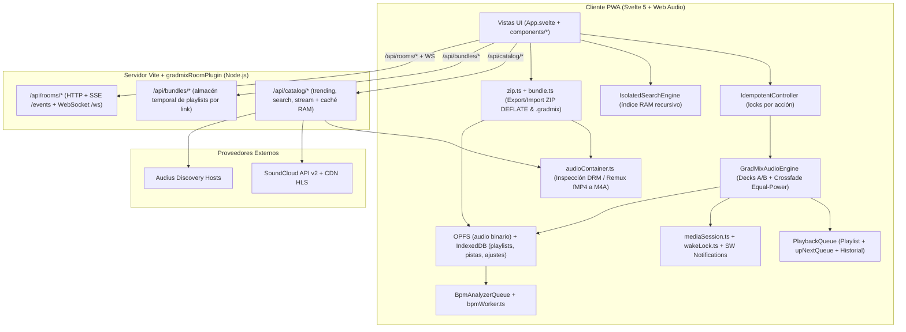

# GradMix — PWA de Mezcla Continua Auto-DJ, Catálogo en Streaming y Salas Colaborativas

**GradMix** es una Progressive Web App (PWA) de audio diseñada para operar como reproductor continuo de fiestas con transición **Auto-DJ (Equal-Power Crossfade)** en doble deck (`A` / `B`), biblioteca local persistente en **OPFS**, buscador aislado en memoria RAM conectado a catálogo remoto, exportación/importación en `.zip` estándar y salas colaborativas temporales en tiempo real.

---

## Tabla de Contenidos

1. [Stack Tecnológico](#stack-tecnológico)
2. [Mapa de Arquitectura](#mapa-de-arquitectura)
3. [Estructura de Carpetas](#estructura-de-carpetas)
4. [Dónde Tocar Cada Cosa (Guía de Mantenimiento)](#dónde-tocar-cada-cosa-guía-de-mantenimiento)
5. [Endpoints HTTP, SSE y WebSocket (`vite-room-plugin.ts`)](#endpoints-http-sse-y-websocket-vite-room-plugints)
6. [Cómo Correr, Compilar y Probar la App](#cómo-correr-compilar-y-probar-la-app)
7. [Decisiones Clave de Ingeniería](#decisiones-clave-de-ingeniería)
8. [Glosario Técnico](#glosario-técnico)

---

## Stack Tecnológico

| Capa | Tecnología / Paquete | Uso en GradMix |
| :--- | :--- | :--- |
| **UI / Estado Reactivo** | **Svelte 5** (`^5.57.3`, runes `$state`, `$derived`, `$effect`) + **TypeScript** (`~6.0.3`) | Componentes desacoplados, estado centralizado en `App.svelte` y validación estática con `svelte-check`. |
| **Estilos** | **Tailwind CSS v4** (`^4.3.5`, `@tailwindcss/vite`) | Interfaz rectangular minimalista (`border-radius: 0`), modo **OLED oscuro** y **modo claro**. |
| **Empaquetador & PWA** | **Vite 8** (`^8.3.6`) + **vite-plugin-pwa** (`^2.0.0`, Workbox) | Compilación, caché offline (`sw.js`) e integración de manejador de notificaciones `sw-media-controls.js`. |
| **Motor de Audio** | **Web Audio API** + `<audio>` (`MediaElementAudioSourceNode`) + `AudioContext` | Doble deck (`A`/`B`), mezcla Equal-Power (`cos`/`sin`), compresor maestro y arranque rápido por streaming. |
| **Almacenamiento Local** | **OPFS** (`Origin Private File System`) + **IndexedDB** (`idb-keyval ^6.3.0`) | Audio binario almacenado en OPFS sin saturar RAM; metadatos, playlists y ajustes en IndexedDB. |
| **Análisis de BPM** | **Web Workers** (`bpmWorker.ts` / `bpmAnalyzer.ts`) + **web-audio-beat-detector** | Cola en segundo plano que detecta BPM y duración sin bloquear el hilo principal. |
| **Backend Embebido** | Plugin personalizado de Vite ([vite-room-plugin.ts](gradmix-pwa/vite-room-plugin.ts)) | Proxy de catálogo (SoundCloud / Audius), servidor temporal de paquetes (`.gradmix` / links) y salas en vivo (HTTP + SSE + WebSocket RFC 6455). |
| **Contenedor Nativo** | **Capacitor** (`^8.6.2`) | Configuración base (`com.gradmix.app`, `webDir: dist`) en `capacitor.config.ts`. |
| **Pruebas** | **Node Test Runner** (`node --test tests/*.test.ts`) | Pruebas unitarias de cola, buscador recursivo, idempotencia, contenedores MP4/ADTS, tags ID3/MP4 y `.zip`. |

---

## Mapa de Arquitectura

La aplicación sigue una arquitectura **local-first con estado unidireccional en frontend** y un **micro-backend acoplado al ciclo dev/preview de Vite**:



### Flujos Críticos de Datos

1. **Reproducción de Baja Latencia (`GradMixAudioEngine.prepareDeckMedia`)**
   - Para archivos `> 1.5 MB`, el deck inicia directamente con `<audio src="blob:...">` conectado a `MediaElementAudioSourceNode`, evitando esperar `decodeAudioData()` completo antes de sonar.
   - El planificador (`setInterval` de 250 ms) pre-carga la siguiente pista ~25 s antes del final en el deck libre y dispara el **Crossfade Equal-Power** (`cos`/`sin`) cuando resta `crossfadeSeconds`.

2. **Normalización de Streams y Exportación `.m4a` + `.zip`**
   - Muchos streams HLS `audio/mp4` vienen como **fMP4** (`ftyp + moov(dur=0) + moof/mdat`), lo que provoca que reproductores de escritorio calculen duraciones erróneas (p. ej. centenas de horas).
   - `remuxFragmentedMp4ToStandardM4a()` reempaqueta el flujo sin recodificar el audio a un `.m4a` ISO-BMFF estándar (`ftyp M4A ` + `moov` completo con `mvhd`, `mdhd`, `stts`, `stsc`, `stsz`, `stco` + `mdat` único), tanto en el servidor (`/api/catalog/stream`) como al exportar `.zip` (`buildPlaylistZipBlob`).
   - `buildZipBlobFromEntries()` comprime cada canción individual usando `CompressionStream('deflate-raw')` (método `8` cuando reduce tamaño, respaldo `0` `STORE` en caso contrario).

3. **Cola Prioritaria ("Añadir a la cola")**
   - `PlaybackQueue.enqueueNext()` inserta pistas (locales o externas en RAM) en `upNextQueue`.
   - `peekNextTrackId()` y `advanceNext()` consumen primero `upNextQueue` en orden FIFO y, al vaciarse, reanudan la playlist exactamente en la posición siguiente (`resumePlaylistPos`).

4. **Buscador Aislado en RAM (`IsolatedSearchEngine`)**
   - Cero lecturas a IndexedDB/OPFS al teclear.
   - Normaliza acentos, mayúsculas/minúsculas y puntuación (`normalizeSearchText`) y puntúa de forma recursiva con memoización (`recursiveMatchTokens`, `recursiveSubsequenceScore`, `resolveCachedPrefixRecursive`).

5. **Controles fuera del navegador sin VAPID**
   - Combina **Media Session API** (`mediaSession.ts`) para controles nativos en pantalla de bloqueo / panel del SO + una notificación persistente local (`showNotification` vía `ServiceWorkerRegistration`) cuyos botones (`prev`, `toggle`, `next`, `close`) son capturados por [sw-media-controls.js](gradmix-pwa/public/sw-media-controls.js) y reenviados por `postMessage` a `App.svelte`.

---

## Estructura de Carpetas

```text
DjARC/
├── capacitor.config.json          # Metadatos Capacitor en raíz
├── docs/                          # Material de diseño e imágenes de referencia
├── package.json                   # Dependencias compartidas en raíz
└── gradmix-pwa/                   # Aplicación principal (Vite + Svelte + PWA)
    ├── vite.config.ts             # Plugins Tailwind, Svelte, gradmixRoomPlugin y VitePWA
    ├── vite-room-plugin.ts        # Middleware HTTP/SSE/WebSocket (/api/catalog, /api/bundles, /api/rooms)
    ├── capacitor.config.ts        # Configuración Capacitor (com.gradmix.app -> dist/)
    ├── package.json               # Scripts: dev, build, preview, check
    ├── public/
    │   ├── manifest.json          # Manifiesto PWA instalable
    │   ├── sw-media-controls.js   # Listener notificationclick en SW para controles multimedia locales
    │   └── icons/                 # Íconos PWA (192, 512, maskable)
    ├── tests/                     # Suite de pruebas unitarias (node:test)
    │   ├── audioContainer.test.ts
    │   ├── audioTagsAndFormats.test.ts
    │   ├── idempotency.test.ts
    │   ├── queue.test.ts
    │   ├── search.test.ts
    │   └── zip.test.ts
    └── src/
        ├── App.svelte             # Orquestador principal de estado, efectos, OPFS/IDB y vistas
        ├── app.css                # Tailwind v4 + variantes de tema y estilos globales rectangulares
        ├── main.ts                # Punto de entrada de montaje Svelte
        ├── components/            # Módulos visuales de UI
        │   ├── SidebarNav.svelte          # Menú lateral / hamburguesa móvil
        │   ├── PlayerDeck.svelte          # Vista principal del reproductor + decks + favoritos/playlist
        │   ├── BottomPlayerBar.svelte     # Barra inferior colapsable (título, play/pause, siguiente, cola)
        │   ├── CrossfadeControl.svelte    # Selector 4s/8s/12s y switch Auto-DJ
        │   ├── PlaylistManager.svelte     # CRUD playlists, carga múltiple, orden, envío WhatsApp y .zip/link
        │   ├── SearchResultsView.svelte   # Página "Coincidencias" (locales + catálogo + añadir a cola/playlist)
        │   ├── FavoritesView.svelte       # Lista y reproducción rápida de favoritas
        │   ├── MonitoringView.svelte      # Uso de cuota OPFS/RAM, decks en vivo y vaciado de base local
        │   ├── RoomView.svelte            # Sala colaborativa temporal (Host/Invitado, permisos, subida)
        │   ├── BlackoutOverlay.svelte     # Modo "Ahorro de batería" AMOLED/negro con controles mínimos
        │   └── ConfirmModal.svelte        # Modal reutilizable de confirmación
        └── lib/
            ├── types.ts                   # Contratos e interfaces globales del dominio
            ├── api/
            │   └── audius.ts              # Cliente HTTP hacia /api/catalog/* y validación de descarga
            ├── audio/
            │   ├── audioEngine.ts         # Motor dual-deck Web Audio + streaming + crossfade
            │   ├── audioContainer.ts      # Detección DRM/contenedores, extractor ADTS y remuxer fMP4->M4A
            │   ├── mediaSession.ts        # Metadata y handlers MediaSession del navegador
            │   └── wakeLock.ts            # Wrapper Wake Lock API para evitar suspensión de pantalla
            ├── search/
            │   └── searchEngine.ts        # Motor aislado recursivo en RAM y caché de prefijos
            ├── storage/
            │   ├── db.ts                  # Persistencia IndexedDB (tracks, playlists, settings)
            │   └── opfsStorage.ts         # Lectura/escritura de blobs en OPFS + fallback IndexedDB
            ├── utils/
            │   ├── audioTags.ts           # Lectura de etiquetas ID3v2 y átomos MP4 (título/artista)
            │   ├── bundle.ts              # Construcción de .zip de playlist y paquetes binarios .gradmix
            │   ├── format.ts              # Formateo de tiempos, limpieza de títulos y MIME soportados
            │   ├── idempotency.ts         # IdempotentController y claves de idempotencia
            │   ├── queue.ts               # PlaybackQueue (orden, shuffle, repeat, historial, upNextQueue)
            │   ├── whatsapp.ts            # Generación de enlaces wa.me para playlists/salas
            │   └── zip.ts                 # Constructor/lector .zip estándar (DEFLATE vía CompressionStream)
            └── workers/
                ├── bpmAnalyzer.ts         # Gestor de cola secuencial para análisis de BPM en segundo plano
                └── bpmWorker.ts           # Web Worker de cálculo de BPM
```

---

## Dónde Tocar Cada Cosa (Guía de Mantenimiento)

| Si necesitas modificar... | Archivo(s) principal(es) | Símbolos / Secciones clave |
| :--- | :--- | :--- |
| **Navegación general, temas, modales globales o flujo de reproducción** | [App.svelte](gradmix-pwa/src/App.svelte) | `handleSelectAudiusTrack`, `playLibraryTrack`, `handleQueueNextLocalTrack`, `handleAddTrackToChosenPlaylist`, `$effect` de `engine.syncLibrary` (envuelto en `untrack`). |
| **Motor de mezcla, crossfade o velocidad de arranque** | [audioEngine.ts](gradmix-pwa/src/lib/audio/audioEngine.ts) | `GradMixAudioEngine`, `prepareDeckMedia`, `executeCrossfade`, `enqueueNext`, `runSchedulerTick`. |
| **Orden de reproducción, modo aleatorio o cola "Siguiente"** | [queue.ts](gradmix-pwa/src/lib/utils/queue.ts) | `PlaybackQueue` (`setPlaylistOrder`, `enqueueNext`, `peekNextTrackId`, `advanceNext`, `stepPrevious`, `getAnchorIndexForNext`). |
| **Barra inferior desplegable (título, pausa, siguiente, cola)** | [BottomPlayerBar.svelte](gradmix-pwa/src/components/BottomPlayerBar.svelte) | Props `upNextTracks`, `hasPlaylistInPlayback`, `onRequestAddToPlaylist`. |
| **Reproductor principal y controles de transporte** | [PlayerDeck.svelte](gradmix-pwa/src/components/PlayerDeck.svelte) | Botones de transporte, barra seek, favoritos y botón de añadir a playlist. |
| **Playlists (subida, renombrado, envío por WhatsApp, `.zip` y links)** | [PlaylistManager.svelte](gradmix-pwa/src/components/PlaylistManager.svelte) | `onExportBundleFile`, `onExportBundleLink`, `onImportFromFile`, `onImportFromLink`, `onQueueNextTrack`. |
| **Compresión `.zip` y lectura/extracción `.zip`** | [zip.ts](gradmix-pwa/src/lib/utils/zip.ts) y [bundle.ts](gradmix-pwa/src/lib/utils/bundle.ts) | `buildZipBlobFromEntries`, `parsePlaylistZipFile`, `buildPlaylistZipBlob`, `buildGradmixBundleBlob`. |
| **Reparación de `.m4a` fragmentados, filtros DRM o formatos** | [audioContainer.ts](gradmix-pwa/src/lib/audio/audioContainer.ts) y [format.ts](gradmix-pwa/src/lib/utils/format.ts) | `inspectAudioContainer`, `remuxFragmentedMp4ToStandardM4a`, `extractAdtsFromFragmentedMp4`, `orderSoundCloudTranscodings`. |
| **Buscador instantáneo (local + catálogo)** | [searchEngine.ts](gradmix-pwa/src/lib/search/searchEngine.ts) y [SearchResultsView.svelte](gradmix-pwa/src/components/SearchResultsView.svelte) | `IsolatedSearchEngine`, `normalizeSearchText`, `recursiveSubsequenceScore`. |
| **Proxy SoundCloud/Audius, cachés de streaming o Salas Colaborativas** | [vite-room-plugin.ts](gradmix-pwa/vite-room-plugin.ts) | `resolveSoundCloudClientId`, `streamSoundCloudFullTrack`, `searchSoundCloudCatalog`, `handleBundleApi`, `handleHttp`, servidor WebSocket `/api/rooms/:code/ws`. |
| **Almacenamiento OPFS / IndexedDB y monitoreo de cuota** | [opfsStorage.ts](gradmix-pwa/src/lib/storage/opfsStorage.ts), [db.ts](gradmix-pwa/src/lib/storage/db.ts), [MonitoringView.svelte](gradmix-pwa/src/components/MonitoringView.svelte) | `saveAudioFile`, `readAudioBlob`, `getStorageUsage`, `clearAllAudioFiles`. |
| **Notificaciones locales y MediaSession (sin VAPID)** | [mediaSession.ts](gradmix-pwa/src/lib/audio/mediaSession.ts) y [sw-media-controls.js](gradmix-pwa/public/sw-media-controls.js) | `registerMediaSessionHandlers`, `updateMediaSessionMetadata`, evento `notificationclick` en SW. |
| **Bloqueos anti doble clic / peticiones idempotentes** | [idempotency.ts](gradmix-pwa/src/lib/utils/idempotency.ts) | `IdempotentController` (`run`, `minLockMs`). |

---

## Endpoints HTTP, SSE y WebSocket (`vite-room-plugin.ts`)

El plugin [vite-room-plugin.ts](gradmix-pwa/vite-room-plugin.ts) corre embebido tanto en `vite dev` como en `vite preview` (manteniendo estado en memoria y caché temporal de servidor).

### Catálogo Remoto (`/api/catalog/*`)
- `GET /api/catalog/trending?limit=16`: devuelve pistas populares (priorizando catálogo SoundCloud y respaldo Audius) con caché TTL en servidor.
- `GET /api/catalog/search?q=<texto>&limit=24`: busca canciones por título/artista con caché LRU/TTL de búsquedas.
- `GET /api/catalog/stream?trackId=<id>&host=<opcional>`: descarga/ensambla el stream completo, descarta pistas cifradas con DRM, remuxa `fMP4 -> .m4a` estándar si aplica y lo cachea en RAM temporal para acelerar repeticiones.

### Empaquetado Temporal de Playlists por Enlace (`/api/bundles`)
- `POST /api/bundles`: recibe un paquete `.gradmix` y devuelve un `bundleId` temporal para compartir por URL (`?import=...`).
- `GET /api/bundles/:id`: descarga el paquete compartido para importarlo automáticamente en el navegador receptor.

### Salas Colaborativas Temporales (`/api/rooms/*`)
- `POST /api/rooms`: crea una sala temporal (hasta 10 h, idempotente vía header `Idempotency-Key`).
- `GET /api/rooms/:code`: consulta el estado público actual de la sala.
- `DELETE /api/rooms/:code`: cierra la sala (solo host).
- `POST /api/rooms/:code/join`: une a un invitado mediante código+clave o token directo de invitación (`token`).
- `POST /api/rooms/:code/permissions`: actualiza privilegios granulares de participantes (`canSkip`, `canPause`, `canAdd`, `canRemove`).
- `POST /api/rooms/:code/tracks`, `GET /api/rooms/:code/tracks/:id/audio`, `DELETE /api/rooms/:code/tracks/:id`: gestión de cola compartida de la sala.
- `POST /api/rooms/:code/command` y `POST /api/rooms/:code/state`: comandos remotos (`play`, `pause`, `next`, `prev`) y sincronización de estado del host.
- `GET /api/rooms/:code/events` (**SSE**) y `WS /api/rooms/:code/ws` (**WebSocket RFC 6455**): transmisión en tiempo real de participantes, privilegios, pistas, estado y comandos.

---

## Cómo Correr, Compilar y Probar la App

> **Importante:** Todos los scripts de Vite y pruebas viven dentro de la carpeta `gradmix-pwa/`.

### 1. Instalar dependencias
```powershell
cd gradmix-pwa
npm install
```

### 2. Modo Desarrollo (HMR / recarga en caliente)
```powershell
cd gradmix-pwa
npm run dev
```
- Disponible en `http://localhost:5173` y en tu IP de red local (`server.host: true`).
- En este modo el Service Worker PWA permanece desactivado (`devOptions.enabled: false`).

### 3. Modo Producción / PWA (`build` + `preview`)
```powershell
cd gradmix-pwa
npm run build
npm run preview
```
- `vite build` genera la aplicación optimizada y el Service Worker en `gradmix-pwa/dist/`.
- `vite preview` levanta la PWA completa con Service Worker y backend `/api/*` en `http://localhost:4173` (puedes fijar puerto con `npx vite preview --host 127.0.0.1 --port 4173 --strictPort`).

### 4. Exponer por HTTPS para probar PWA / móviles (`cloudflared`)
Las APIs de PWA instalable, OPFS persistente y `WakeLock` requieren contexto seguro (`https://` o `localhost`). Para probar desde un celular en red externa:
```powershell
cloudflared tunnel --url http://127.0.0.1:4173
```

### 5. Chequeo de tipos y pruebas unitarias
```powershell
cd gradmix-pwa
npm run check
node --test tests/*.test.ts
```

### 6. Sincronización nativa opcional (Capacitor)
```powershell
cd gradmix-pwa
npm run build
npx cap sync
```

---

## Decisiones Clave de Ingeniería

- **Evitar bucles reactivos en Svelte 5:** En [App.svelte](gradmix-pwa/src/App.svelte), el `$effect` que llama a `engine.syncLibrary(...)` lee `engineSnapshot.currentTrackId` dentro de `untrack(...)` porque `syncLibrary` vuelve a emitir `engineSnapshot`; omitir `untrack` dispararía `effect_update_depth_exceeded`.
- **Cero bloqueo de UI en carga inicial de pistas:** Decodificar por completo un MP3/M4A de varios megabytes vía `AudioContext.decodeAudioData()` introduce segundos de espera en móvil. Por eso `prepareDeckMedia()` usa `<audio>` en streaming para pistas `> 1.5 MB` y reserva la decodificación PCM en memoria como respaldo o para pistas cortas.
- **Compatibilidad universal del `.m4a` exportado:** El remuxer de `audioContainer.ts` reescribe encabezados `moov`/`mvhd`/`stbl` sin recodificar muestras AAC, corrigiendo duraciones corruptas en reproductores externos y respetando el audio original sin pérdida de calidad.
- **Resiliencia en OPFS + IndexedDB:** La metadata vive en IndexedDB y los archivos binarios en OPFS. Si el almacenamiento se acerca al 80% de cuota se alerta al usuario y se ofrece vaciado completo desde Monitoreo.

---

## Glosario Técnico

- **OPFS (`Origin Private File System`):** Sistema de archivos privado por origen del navegador optimizado para leer/escribir binarios grandes en disco sin cargar toda la biblioteca en RAM.
- **fMP4 (Fragmented MP4):** Variante de MP4 usada en HLS donde la duración global en `mvhd` suele venir en `0` y las muestras se reparten en pares `moof` + `mdat`.
- **Remuxing (`fMP4 -> .m4a` estándar):** Reempaquetado de contenedores sin recomprimir los frames AAC, reconstruyendo `moov` y un único `mdat` para compatibilidad total con reproductores de escritorio y móviles.
- **Equal-Power Crossfade:** Curva de mezcla por ganancias $\cos(\theta)$ y $\sin(\theta)$ que mantiene constante la energía percibida durante la transición entre Deck A y Deck B.
- **Idempotency Controller (`IdempotentController`):** Controlador de bloqueos por clave de operación que descarta dobles clics/taps rápidos mientras una operación sigue en curso.
- **Up-Next Queue (`enqueueNext`):** Cola prioritaria FIFO independiente de la playlist activa que reproduce pistas inmediatamente después de la canción en curso y luego retoma la playlist.
- **MediaSession + SW Notifications (sin VAPID):** Integración local del SO que permite controlar Play/Pause, Siguiente y Anterior desde la barra de notificaciones o pantalla bloqueada sin servidor Push ni claves VAPID.
- **Wake Lock (`Screen Wake Lock API`):** Bloqueo temporal que impide que la pantalla del dispositivo se apague durante la reproducción o en **Ahorro de batería**.
- **ZIP DEFLATE / STORE:** Métodos `8` (compresión zlib sin cabecera / RFC 1951 vía `CompressionStream('deflate-raw')`) y `0` (almacenamiento sin compresión cuando los datos no comprimen más).
