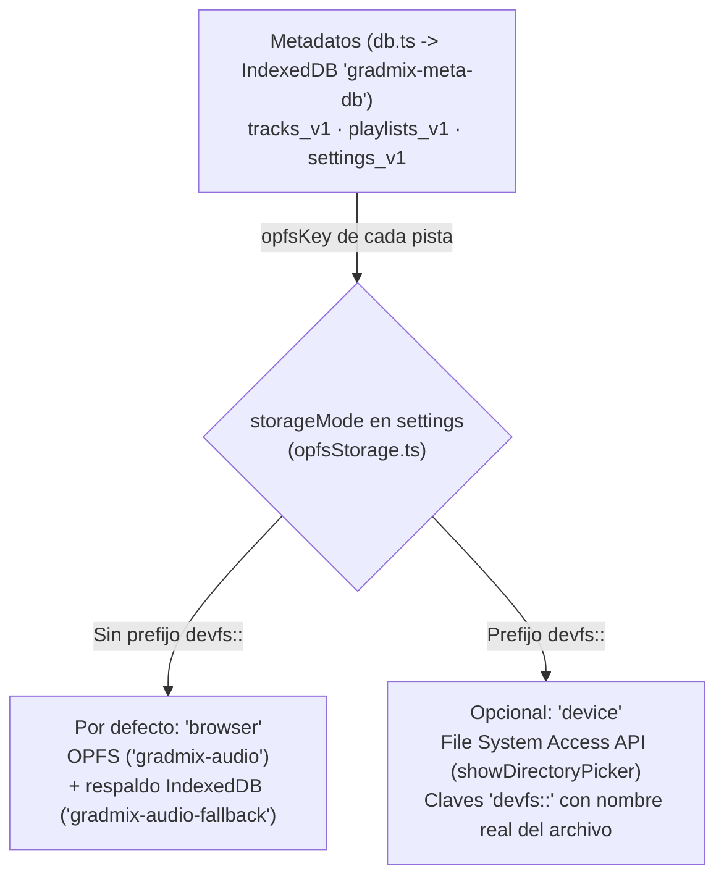

# Almacenamiento Local, Formatos de Audio y Seguridad (`ALMACENAMIENTO-Y-SEGURIDAD-OV`)

> Documento auxiliar del [`README.md`](../README.md). Documenta cómo persiste GradMix las canciones y metadatos en el dispositivo, cómo repara/empaqueta contenedores de audio y cuál es su modelo de seguridad y privacidad.

---

## 1. Arquitectura de Almacenamiento Local en 3 Capas

Toda la biblioteca del usuario vive en el navegador/dispositivo del usuario, separando estrictamente **metadatos** de **archivos binarios pesados**:

### Detalles operativos importantes (`opfsStorage.ts` y `db.ts`)

1. **Metadatos (`gradmix-pwa/src/lib/storage/db.ts`)**:
   - Base `gradmix-meta-db` (tienda `gradmix-meta-store`) gestionada con `idb-keyval`.
   - Claves: `tracks_v1`, `playlists_v1` (por defecto `Playlist Principal` -> `pl-main-party`) y `settings_v1` (`crossfadeSeconds: 8`, `autoDjEnabled: true`, `masterVolume: 0.92`, `theme: 'dark'`, `storageMode: 'browser'`, `storage90Declined: false`, `deviceStorageName: ''`).
2. **Almacenamiento por defecto (`OPFS` + respaldo `IndexedDB`)**:
   - `OPFS` (`Origin Private File System`) permite leer y escribir binarios grandes fuera del Heap JS con rendimiento cercano a disco nativo.
   - Si el navegador no soporta OPFS (ej. ciertos modos privados antiguos), cae de forma transparente a `gradmix-audio-fallback` en IndexedDB.
3. **Almacenamiento interno en carpeta del dispositivo (`devfs::`)**:
   - Activado desde *Monitoreo* (**Almacenamiento interno**), o mediante los avisos proactivos cuando la cuota OPFS alcanza el **90%** (recomendación) o **99%** (bloqueo de nuevas escrituras en navegador).
   - Utiliza `window.showDirectoryPicker({ id: 'gradmix-library', mode: 'readwrite' })` y guarda el `FileSystemDirectoryHandle` en `gradmix-device-fs-db`.
   - Escribe archivos con nombres legibles sanitizados (ej. `Artista - Titulo.mp3`) en lugar de UUIDs ilegibles, asignando `opfsKey` con prefijo `devfs::` para que la app muestre el **ícono de carpeta** en *Playlists* y *Favoritos*.
   - Al pulsar **Eliminar acceso** en la tarjeta de almacenamiento interno de `MonitoringView.svelte`, solo se revoca la vinculación (`storageMode` vuelve a `'browser'`), sin borrar las canciones que ya existen en esa carpeta del disco.
   - El botón **Borrar datos** en *Monitoreo* limpia el almacenamiento local de la app tras confirmación en `ConfirmModal.svelte`.

---

## 2. Procesamiento de Audio y Exportación (`.m4a`, `.zip`, `.gradmix`)

| Capacidad | Módulo | Qué hace exactamente |
| :--- | :--- | :--- |
| **Inspección y filtro DRM** | [`audioContainer.ts`](../gradmix-pwa/src/lib/audio/audioContainer.ts) | Inspecciona cabeceras reales de contenedor antes de guardar/reproducir (`inspectAudioContainer`), rechazando payloads corruptos o protegidos por DRM. |
| **Remuxing `fMP4 -> .m4a`** | [`audioContainer.ts`](../gradmix-pwa/src/lib/audio/audioContainer.ts) | Los streams HLS fragmentados (`moof`/`mdat` con duración `0` en `mvhd`) se reconstruyen bit a bit en un `.m4a` ISO-BMFF estándar (`moov` completo + único `mdat`) **sin recodificar AAC** ni perder calidad. También soporta extracción ADTS (`extractAdtsFromFragmentedMp4`). |
| **Etiquetas ID3v2 / MP4** | [`audioTags.ts`](../gradmix-pwa/src/lib/utils/audioTags.ts) | Lee metadatos reales embebidos (título y artista) de archivos MP3 (ID3v2) y M4A/MP4 al importarlos. |
| **Exportación `.zip`** | [`zip.ts`](../gradmix-pwa/src/lib/utils/zip.ts) + [`bundle.ts`](../gradmix-pwa/src/lib/utils/bundle.ts) | Empaqueta cualquier playlist remuxando `fMP4` si hace falta y comprimiendo con `CompressionStream('deflate-raw')` (método `8` DEFLATE o `0` STORE si no reduce tamaño), sin dependencias externas. |
| **Paquete binario `.gradmix`** | [`bundle.ts`](../gradmix-pwa/src/lib/utils/bundle.ts) | Formato propio `GMXB` v1 (cabecera + manifiesto JSON + binarios concatenados) para respaldo directo e importación rápida dentro de GradMix. |

---

## 3. Modelo de Seguridad y Privacidad por Capas

### 3.1 Cliente (Sandbox del Navegador)
- **Zero-knowledge por defecto**: no existe registro de cuentas, ni telemetría/analíticas, ni micrófono (`getUserMedia`), cámara o geolocalización.
- **Sin inyección DOM insegura**: el código en `gradmix-pwa/src/` evita `innerHTML`, `{@html}` y `eval()`; Svelte escapa automáticamente títulos y metadatos procedentes de etiquetas ID3/MP4 o búsquedas externas.
- **Permisos explícitos de disco**: `OPFS`/`IndexedDB` están estrictamente aislados al origen `https://gradmix.arc03.online`; el modo `devfs::` solo accede a la carpeta única elegida manualmente por el usuario.

### 3.2 Compartición Cifrada (`shareCrypto.ts`)
- Todo paquete compartido por link usa **AES-256-GCM** en el cliente (`crypto.subtle`) con IV aleatorio de **12 bytes** por operación y clave aleatoria de **256 bits** colocada exclusivamente en el fragmento `#k=...` del enlace (nunca enviada en cabeceras HTTP hacia Cloudflare ni Vercel).

### 3.3 Backend de Salas y Bundles (`gradmix-api`)
- **Claves de sala**: derivadas con **PBKDF2-SHA256** a `12_000` iteraciones y sal aleatoria de 12 bytes por sala, comparadas con `timingSafeStringEqual` ([`shared.ts`](../gradmix-api/src/shared.ts)).
- **Autorización en servidor**: cada mutación de sala (`command`, `tracks`, `permissions`, `DELETE /participants/:id`, `DELETE /rooms/:code`) verifica en el Durable Object la identidad (`hostId` / `participantId`) y los permisos granulares (`canSkip`, `canPause`, `canAdd`, `canRemove`), nunca confiando solo en la UI.
- **Presencia y revocación inmediata**: los latidos `seen:<participantId>` persistidos en `DurableObjectStorage` sobreviven a la hibernación; al pasar `GUEST_INACTIVITY_MS` (`10 s`), el invitado pierde acceso inmediato (`403`) a `/now-audio`, estado y WebSocket.
- **Límites estrictos y autodestrucción**:
  - Cabecera `Content-Length` obligatoria (`411` si falta) y límite máximo de **35 MB** (`MAX_UPLOAD_BYTES`) por pista en salas y bundles.
  - `ALLOWED_ORIGINS` en [`wrangler.jsonc`](../gradmix-api/wrangler.jsonc) con `Vary: Origin` y rechazo `403` para orígenes no autorizados en `OPTIONS`.
  - Alarmas de Durable Object limpian automáticamente R2 y almacenamiento al vencer el TTL (`0.25 h`–`10 h` en salas, `24 h` en bundles).

---

## 4. Variables de Entorno y Requisitos

Archivo de referencia: [`gradmix-pwa/.env.example`](../gradmix-pwa/.env.example)

| Variable | Dónde | Valor en Desarrollo | Valor en Producción |
| :--- | :--- | :--- | :--- |
| `VITE_API_BASE` | `gradmix-pwa/.env` / Vercel | Vacío (`""`) para usar el proxy de Vite a `127.0.0.1:8787` | `https://api.gradmix.arc03.online` |
| `ALLOWED_ORIGINS` | `gradmix-api/wrangler.jsonc` | Incluye `localhost:5173` / `4173` | Dominios oficiales de producción + previews verificados de Vercel |
