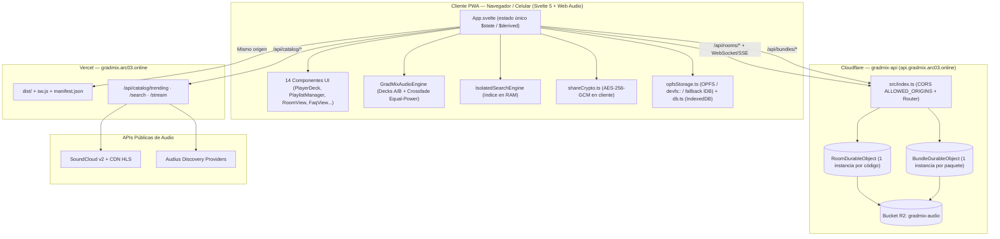
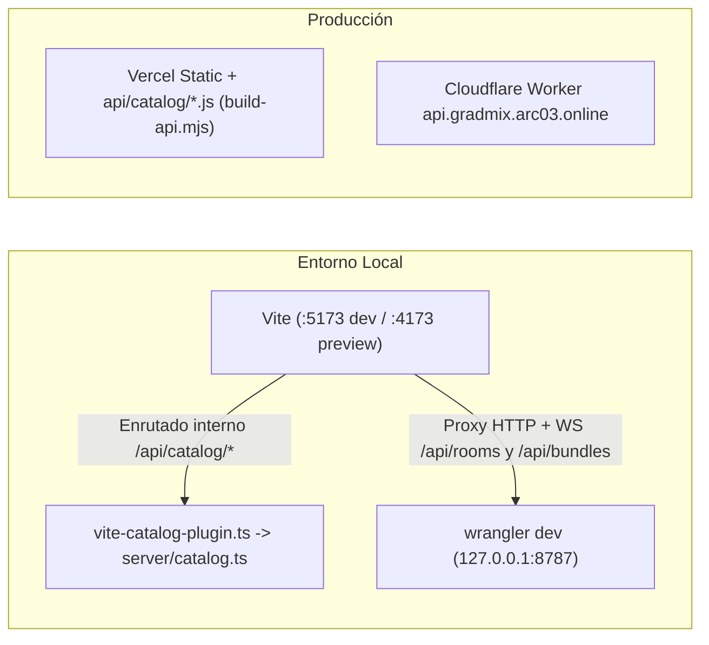
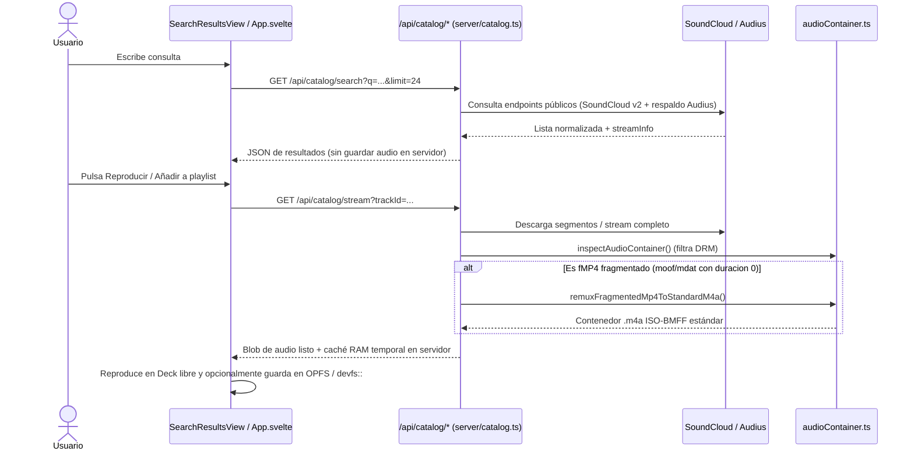

# Arquitectura General y Flujos End-to-End (`ARQUITECTURA-OV`)

> Documento auxiliar del [`README.md`](../README.md). Resume la topología de **GradMix**, cómo se comunican el cliente PWA, Vercel y Cloudflare Workers, y el ciclo de vida de cada flujo crítico.

---

## 1. Visión de Alto Nivel (Topología Híbrida)

GradMix separa deliberadamente dos tipos de cargas de trabajo con naturalezas distintas:

| Capa | Plataforma | Responsabilidad | Estado que persiste |
| :--- | :--- | :--- | :--- |
| **Cliente PWA** | Navegador del usuario / móvil instalado | UI Svelte 5, motor dual-deck Web Audio, búsqueda en RAM, cifrado E2EE en cliente y reproducción offline | Biblioteca completa (`OPFS` / carpeta `devfs::` + `IndexedDB`) |
| **Sitio + Catálogo Serverless** | **Vercel** (`gradmix.arc03.online`) | Servir el bundle estático + Service Worker y exponer `/api/catalog/*` como proxy sin estado | Ninguno en disco; cachés efímeras en RAM de instancia |
| **Backend Real-Time y Temporal** | **Cloudflare Workers** (`api.gradmix.arc03.online`) | Coordinar Salas Colaborativas (`RoomDurableObject`) y enlaces temporales de playlists (`BundleDurableObject`) | Estado en Durable Object + audio temporal en R2 (máx. 10 h / 24 h) |

---

## 2. Paridad entre Desarrollo Local y Producción

No existen dos backends ni mocks distintos entre desarrollo y producción:

- **`apiUrl()` y `apiWsUrl()`** en [`gradmix-pwa/src/lib/api/base.ts`](../gradmix-pwa/src/lib/api/base.ts):
  - Cuando `VITE_API_BASE` está vacío (desarrollo), emite rutas relativas (`/api/rooms/...`, `/api/bundles/...`) que Vite proxea hacia `http://127.0.0.1:8787` (incluyendo WebSocket con `ws: true`).
  - Cuando `VITE_API_BASE` apunta a `https://api.gradmix.arc03.online` (producción en Vercel), las peticiones de salas y bundles van al Worker autorizado por `ALLOWED_ORIGINS`.
- **Catálogo `/api/catalog/*`**:
  - Siempre va al mismo origen del sitio (`window.location.origin`), evitando prefijos CORS adicionales.
  - La lógica vive una sola vez en [`gradmix-pwa/server/catalog.ts`](../gradmix-pwa/server/catalog.ts) y es consumida tanto por [`vite-catalog-plugin.ts`](../gradmix-pwa/vite-catalog-plugin.ts) como por las funciones serverless empaquetadas en [`gradmix-pwa/scripts/build-api.mjs`](../gradmix-pwa/scripts/build-api.mjs) dentro de `gradmix-pwa/api/catalog/*.js`.

---

## 3. Flujo del Catálogo Remoto y Normalización de Streams

Cuando el usuario busca o reproduce una canción desde el catálogo público:

---

## 4. Despliegue Automático vs Manual

| Componente | Trigger | Comando / Configuración | Verificación |
| :--- | :--- | :--- | :--- |
| **Frontend + `/api/catalog/*`** | Push a rama `main` | Vercel (`Root Directory: gradmix-pwa`, `vercel.json` -> `npm run build`, `outputDirectory: dist`) | `https://gradmix.arc03.online` + `curl /api/catalog/trending` |
| **Backend Salas/Bundles** | Manual cuando cambie `gradmix-api/` | `cd gradmix-api && npm run deploy` (`npx --yes wrangler@3.114.15 deploy`) | `node scripts/smoke.mjs https://api.gradmix.arc03.online` (suite end-to-end) |

> Para el detalle completo de DNS, R2, Durable Objects y pasos de verificación en producción, consulta [`DEPLOY_GRADMIX.md`](DEPLOY_GRADMIX.md).

---

## 5. Documentos Relacionados (`-OV`)

- [`MODULOS-UI-OV.md`](MODULOS-UI-OV.md): Diseño de `App.svelte`, los 14 componentes UI, motor dual-deck Web Audio, colas e integración PWA/MediaSession.
- [`SALAS-Y-COMPARTICION-OV.md`](SALAS-Y-COMPARTICION-OV.md): Salas colaborativas en vivo, latidos anti-hibernación, permisos y compartición E2EE por WhatsApp.
- [`ALMACENAMIENTO-Y-SEGURIDAD-OV.md`](ALMACENAMIENTO-Y-SEGURIDAD-OV.md): Persistencia local (`OPFS` / `devfs::` / `IndexedDB`), formatos `.zip`/`.gradmix`/`.m4a` y arquitectura de seguridad.
