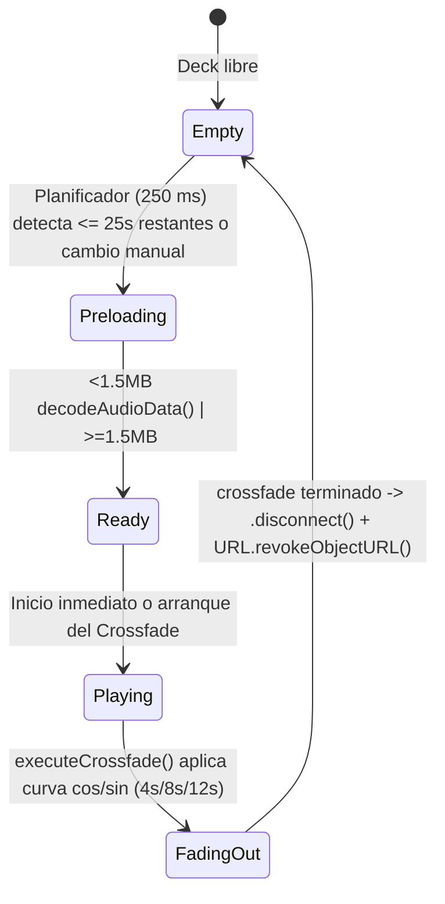

# Frontend Svelte 5, Motor de Audio y Módulos UI (`MODULOS-UI-OV`)

> Documento auxiliar del [`README.md`](../README.md). Detalla la arquitectura interna de `gradmix-pwa/src/`: gestión de estado en `App.svelte`, los 14 componentes de interfaz, el motor dual-deck `GradMixAudioEngine` y la integración con el sistema operativo.

---

## 1. Arquitectura Unidireccional sin Store Global

En `gradmix-pwa/src/` **no hay Redux, Zustand ni `svelte/store`**. Toda la fuente de verdad reside en [`App.svelte`](../gradmix-pwa/src/App.svelte) mediante runas de Svelte 5 (`$state`, `$derived`, `$effect`), siguiendo este flujo estricto:

- `App.svelte` posee el estado de biblioteca (`tracks`, `playlists`), configuración (`settings`), reproducción (`engineSnapshot`), búsqueda (`searchQuery`), sala activa (`room`) y vista actual (`activeModule: AppModule`).
- `AppModule` ([`types.ts`](../gradmix-pwa/src/lib/types.ts)) define las **7 rutas lógicas**:
  `'player' | 'playlists' | 'favorites' | 'monitoring' | 'room' | 'faq' | 'search'`.
- Cada vista hija recibe sus props de solo lectura y emite eventos mediante callbacks (`on...`), manteniendo los componentes puramente presentacionales.
- **Regla crítica de Svelte 5 en `App.svelte`**: el `$effect` que invoca `engine.syncLibrary(...)` lee `engineSnapshot.currentTrackId` dentro de `untrack()` porque `syncLibrary` vuelve a emitir el snapshot; omitir `untrack()` provocaría el error `effect_update_depth_exceeded`.

---

## 2. Mapa de Componentes UI (`src/components/`)

| Componente | Rol | Detalles clave |
| :--- | :--- | :--- |
| [`SidebarNav.svelte`](../gradmix-pwa/src/components/SidebarNav.svelte) | Navegación lateral / cajón móvil | Acceso a Reproductor, Playlists, Favoritos, Monitoreo, Sala en Vivo y Preguntas Frecuentes; botón **Instalar App** cuando `beforeinstallprompt` está disponible. |
| [`PlayerDeck.svelte`](../gradmix-pwa/src/components/PlayerDeck.svelte) | Vista principal del reproductor | Controles Play/Pause, Anterior/Siguiente, barra `seek`, Shuffle/Repeat, marcador de Favorito, botón Añadir a playlist y tarjetas de estado de Deck A / Deck B. |
| [`BottomPlayerBar.svelte`](../gradmix-pwa/src/components/BottomPlayerBar.svelte) | Barra inferior fija y colapsable | Visible al navegar por otras vistas; panel desplegable amplio con barra de progreso en vivo y cola **Siguientes en cola**. |
| [`CrossfadeControl.svelte`](../gradmix-pwa/src/components/CrossfadeControl.svelte) | Control rápido de mezcla | Selector de duración de crossfade (`4s` / `8s` / `12s`) y conmutador de Auto-DJ. |
| [`PlaylistManager.svelte`](../gradmix-pwa/src/components/PlaylistManager.svelte) | Gestor de playlists y compartición | Crear/renombrar/borrar playlists, carga múltiple de audio/carpetas, reordenar (`↑`/`↓`), orden `A-Z`, exportar `.zip` / `.gradmix` / `.json`, generar link cifrado para WhatsApp (con barra de carga en segundo plano), indicador de carpeta local (`devfs::`) por pista e importar desde archivo o URL. |
| [`SharedPlaylistModal.svelte`](../gradmix-pwa/src/components/SharedPlaylistModal.svelte) | Modal estilo Spotify para links compartidos | Muestra el listado recibido por `?share=` o `?import=#k=`; permite pulsar **Reproducir** al instante en RAM (bajo demanda, sin guardar archivos en disco) o **Descargar Playlist** a almacenamiento local. |
| [`SearchResultsView.svelte`](../gradmix-pwa/src/components/SearchResultsView.svelte) | Vista de coincidencias (`search`) | Separa resultados locales instantáneos (`IsolatedSearchEngine`) y resultados remotos de `/api/catalog/search`, con botones para reproducir, añadir a cola o guardar en playlist. |
| [`FavoritesView.svelte`](../gradmix-pwa/src/components/FavoritesView.svelte) | Lista de pistas favoritas | Filtra en memoria las pistas con `favorite: true`, muestra icono de carpeta cuando viven en `devfs::` y ofrece **Reproducir todo**. |
| [`MonitoringView.svelte`](../gradmix-pwa/src/components/MonitoringView.svelte) | Telemetría y almacenamiento | Muestra búferes PCM en RAM (`0 / 2 pistas`), Heap JS, cuota `OPFS + IndexedDB`, tarjeta dedicada de **Almacenamiento interno del dispositivo** (uso, `Cambiar carpeta`, `Eliminar acceso`), botón **Borrar datos** (vaciado total con confirmación) y acordeón de ayuda por plataforma. |
| [`RoomView.svelte`](../gradmix-pwa/src/components/RoomView.svelte) | Sala colaborativa temporal | Modo **Host** (código, clave, QR/WhatsApp, matriz de permisos, expulsión, selector `+ Subir` que inserta al puesto #1) y modo **Invitado** (audio en vivo desde `/now-audio`, mute local, estado solo lectura si es host, cola máx. 5 previews, alerta de expulsión). |
| [`FaqView.svelte`](../gradmix-pwa/src/components/FaqView.svelte) | Preguntas y Respuestas | Filtros por categoría (`Todas`, `Uso y Auto-DJ`, `Licencias y Catálogo`, `Salas en Vivo`, `Almacenamiento`) incluyendo proyecto open source, instalación PWA correcta y privacidad/recopilación de datos. |
| [`AccordionList.svelte`](../gradmix-pwa/src/components/AccordionList.svelte) | Componente acordeón reutilizable | Usado tanto por `FaqView.svelte` como por las guías de almacenamiento en `MonitoringView.svelte`. |
| [`BlackoutOverlay.svelte`](../gradmix-pwa/src/components/BlackoutOverlay.svelte) | Modo Ahorro / Blackout AMOLED | Oscurece la pantalla al negro absoluto mostrando hora, batería (`navigator.getBattery` si aplica) y controles mínimos para evitar sobrecalentamiento y toques accidentales durante eventos largos. |
| [`ConfirmModal.svelte`](../gradmix-pwa/src/components/ConfirmModal.svelte) | Diálogo modal genérico | Confirmaciones destructivas (vaciar datos, eliminar acceso a carpeta, alertas de expulsión o límite de espacio). |

---

## 3. Motor Dual-Deck y Cola de Reproducción

### Puntos clave del motor ([`audioEngine.ts`](../gradmix-pwa/src/lib/audio/audioEngine.ts) y [`queue.ts`](../gradmix-pwa/src/lib/utils/queue.ts))

1. **Arranque sin bloqueos (`prepareDeckMedia`)**:
   - Archivos de hasta ~1.5 MB pueden decodificarse a `AudioBuffer` en RAM.
   - Archivos mayores usan un `<audio src="blob:...">` conectado mediante `MediaElementAudioSourceNode` al mismo grafo de ganancia (`GainNode`), evitando congelar el hilo principal en teléfonos de gama media.
2. **Resolución perezosa en RAM (`setLazyBlobResolver`)**:
   - Permite reproducir pistas de una playlist compartida (`SharedPlaylistModal`) obteniendo y descifrando únicamente la canción actual (y la siguiente precargada) sin guardar toda la lista en OPFS/IndexedDB.
3. **Cola prioritaria flexible (`PlaybackQueue`)**:
   - `enqueueNext(trackId)`: inserta al final de `upNextQueue` ("Añadir a la cola").
   - `enqueueFirst(trackId)`: inserta en la posición `#1` de `upNextQueue` (usado cuando un participante sube una canción en una Sala Colaborativa).
   - `setUpNextOrder(...)` y `removeFromUpNext(...)`: permiten reordenar o quitar elementos desde la sala o cola activa manteniendo intacta la posición `resumePlaylistPos` de la playlist base.
4. **Higiene de memoria (eventos de 10 horas)**:
   - Máximo **2 pistas** activas simultáneamente entre Deck A y Deck B; al finalizar un crossfade, el deck saliente desconecta nodos Web Audio y libera Object URLs.
   - El análisis de BPM corre en segundo plano en [`bpmAnalyzer.ts`](../gradmix-pwa/src/lib/workers/bpmAnalyzer.ts) + [`bpmWorker.ts`](../gradmix-pwa/src/lib/workers/bpmWorker.ts) de forma secuencial para no competir con la decodificación de audio.

---

## 4. Integración con Sistema Operativo y PWA Instalable

- **Controles sin servidor Push (`mediaSession.ts` + `sw-media-controls.js`)**:
  - `registerMediaSessionHandlers` y `updateMediaSessionMetadata` en [`mediaSession.ts`](../gradmix-pwa/src/lib/audio/mediaSession.ts) integran la reproducción con la pantalla bloqueada, botones Bluetooth y relojes.
  - Una notificación local persistente de Service Worker expone botones `prev`, `toggle`, `next` y `close`; [`sw-media-controls.js`](../gradmix-pwa/public/sw-media-controls.js) intercepta `notificationclick` y reenvía la acción por `postMessage` a `App.svelte`.
- **Instalabilidad PWA real (`manifest.json` + `VitePWA`)**:
  - [`vite.config.ts`](../gradmix-pwa/vite.config.ts) genera el Service Worker con Workbox (`navigateFallback: '/index.html'`, excluyendo `/^\/api\//`), importando `/sw-media-controls.js`.
  - [`manifest.json`](../gradmix-pwa/public/manifest.json) declara `display: "standalone"`, `start_url: "/"`, `scope: "/"` e iconos `any` + `maskable`, permitiendo instalación nativa en Android Chrome / escritorio sin descargar páginas offline estáticas.
- **Anti doble toque (`IdempotentController`)**:
  - [`idempotency.ts`](../gradmix-pwa/src/lib/utils/idempotency.ts) bloquea operaciones concurrentes por clave (reproducción, descarga de catálogo, creación de sala, subida de pistas) para evitar ejecuciones duplicadas en móviles.
