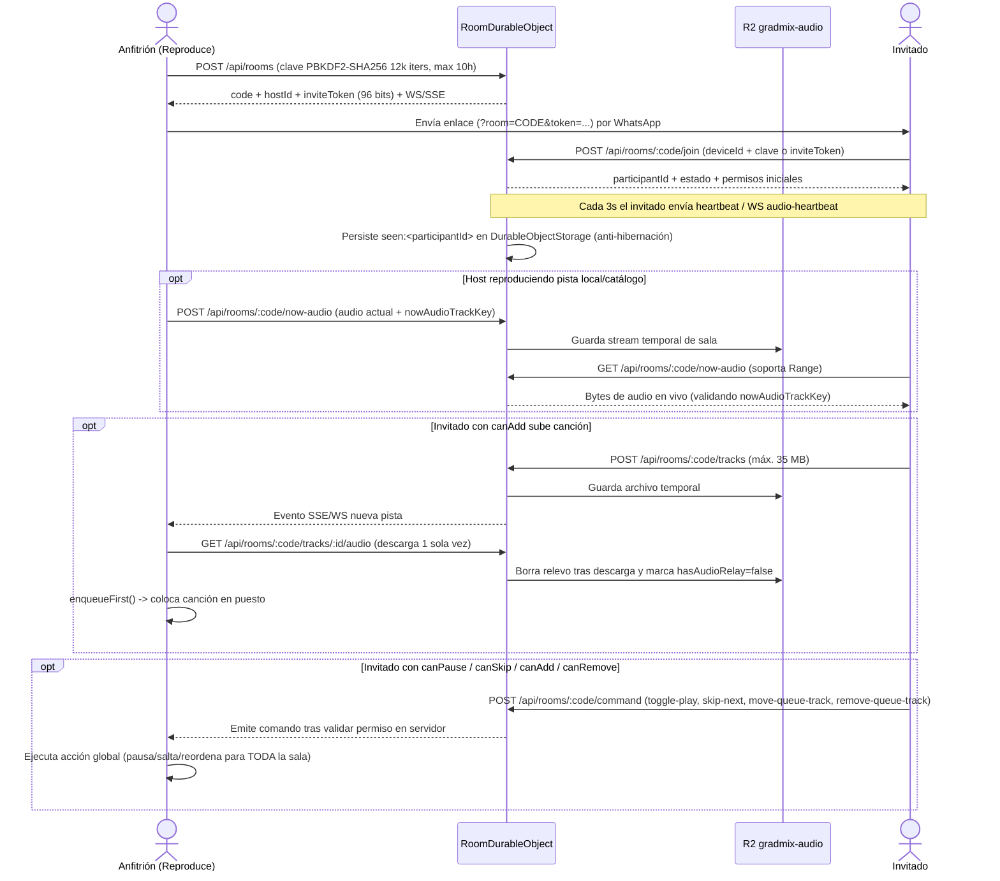
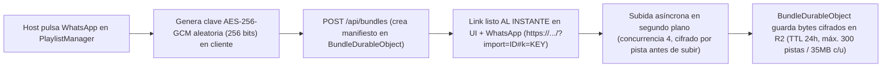

# Salas Colaborativas en Vivo y Compartición E2EE (`SALAS-Y-COMPARTICION-OV`)

> Documento auxiliar del [`README.md`](../README.md). Explica el funcionamiento interno de las **Salas Temporales** y el **envío de Playlists cifradas por WhatsApp** implementados entre `gradmix-pwa` y `gradmix-api`.

---

## 1. Salas Colaborativas (`RoomDurableObject` + R2)

Cada sala está respaldada por una instancia dedicada de `RoomDurableObject` ([`gradmix-api/src/room.ts`](../gradmix-api/src/room.ts)) identificada por su código normalizado de sala (alfabeto sin ambigüedades `ABCDEFGHJKLMNPQRSTUVWXYZ23456789` de 6 caracteres por defecto o código personalizado).

### Ciclo de vida completo de una Sala

### Reglas y garantías de diseño en Salas

1. **Pausa y control global**: cuando un invitado con permiso `canPause` pulsa pausa/play, el comando `toggle-play` viaja al host para pausar/reanudar la reproducción maestra de **toda la sala** (y todos los invitados sincronizan su audio vivo acorde al estado del host), evitando pausas aisladas que desincronizan a los asistentes.
2. **Solo el host reproduce**: en la vista de sala del anfitrión, los controles centrales de reproducción son informativos de estado (el control maestro está en el reproductor del host), mientras los invitados tienen botón de silencio local (*mute*).
3. **Inserción prioritaria y vista compacta de cola**: cualquier pista subida a la sala pasa al primer turno siguiente (`enqueueFirst`), y el resumen público `playbackQueue` mostrado en la vista de sala se limita a un máximo de 5 próximos temas para mantener la UI limpia.
4. **Anti-hibernación y expulsión por inactividad (`10 s`)**:
   - Si el Durable Object entra en hibernación entre eventos de Cloudflare Workers, la marca `seen:<participantId>` persistida en `ctx.storage` conserva el último latido real de cada invitado.
   - Si un invitado deja de enviar latidos por más de `GUEST_INACTIVITY_MS` (`10_000 ms`), el servidor lo remueve, notifica `room-kicked` y rechaza futuros accesos (`/now-audio`, `/ws`, estado) con `403`.
   - En el cliente, el invitado expulsado recibe un modal con `X` que redirige al módulo `player`; además hay guarda de navegación hacia atrás (`popstate` / `beforeunload`) para evitar salidas accidentales.
5. **Reconexión sin duplicados**: `deviceId` permite reutilizar el registro del mismo invitado si recarga la página, evitando filas fantasma en la tabla de participantes.

---

## 2. Compartición de Playlists por WhatsApp (`?share=` y `?import=#k=`)

GradMix no envía listas en texto plano por WhatsApp: [`whatsapp.ts`](../gradmix-pwa/src/lib/utils/whatsapp.ts) genera un mensaje limpio (sin emojis incompatibles) con un hipervínculo directo que abre [`SharedPlaylistModal.svelte`](../gradmix-pwa/src/components/SharedPlaylistModal.svelte) en el navegador receptor.

Existen **dos modos automáticos** cifrados en [`shareCrypto.ts`](../gradmix-pwa/src/lib/utils/shareCrypto.ts):

### Modo A: Zero-Server (`?share=...`) para pistas del catálogo público
- Si todas las canciones de la playlist tienen `catalogId`, no se usa ningún almacenamiento de servidor (`gradmix-api` ni R2).
- Los metadatos mínimos (`catalogId`, `title`, `artist`, `duration`) se serializan, cifran con **AES-256-GCM** y viajan directamente codificados en `Base64URL` dentro de `?share=...`.
- Al abrir el enlace, el receptor descifra en memoria la lista y reproduce cada tema desde `/api/catalog/stream`.

### Modo B: Enlace Temporal E2EE (`?import=<id>#k=<aes256Key>`) para archivos locales
Cuando la playlist incluye pistas locales (MP3/M4A/WAV/FLAC/OGG):

- **Por qué el link aparece al instante**: el manifiesto (`POST /api/bundles`) se crea primero y la URL con `#k=<clave>` se muestra de inmediato en pantalla (y se puede cancelar si el usuario cambia de opinión), mientras las pistas cifradas en cliente con WebCrypto (`IV de 12 bytes + ciphertext AES-GCM`) suben en paralelo al Worker en segundo plano.
- **Reproducción estilo Spotify en el receptor**:
  - La clave `#k=` viaja en el *fragmento URL*, por lo que **nunca se envía en peticiones HTTP al servidor** ni aparece en logs de red.
  - Si el receptor pulsa **Reproducir**, `audioEngine.setLazyBlobResolver()` descarga y descifra en RAM **solo la canción actual** (sin ocupar OPFS ni escribir archivos permanentes).
  - Si el receptor pulsa **Descargar Playlist**, todas las pistas se descifran, validan y guardan en el almacenamiento configurado (`OPFS` o `devfs::`).
